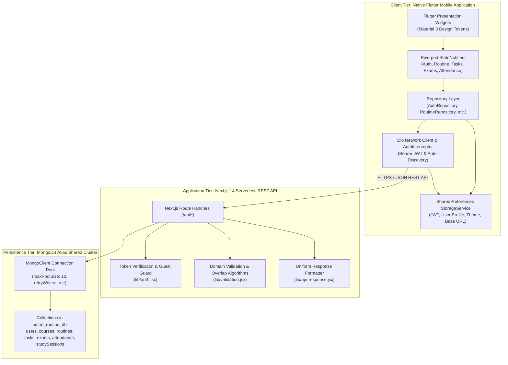
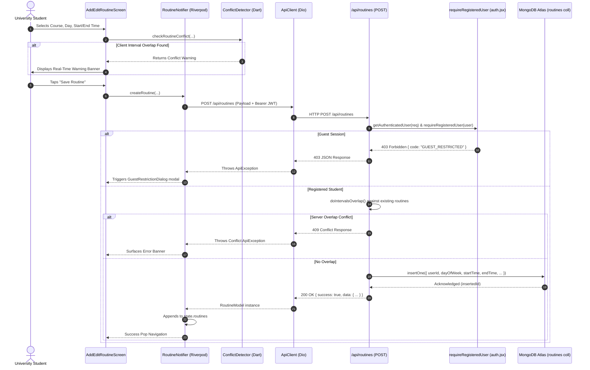
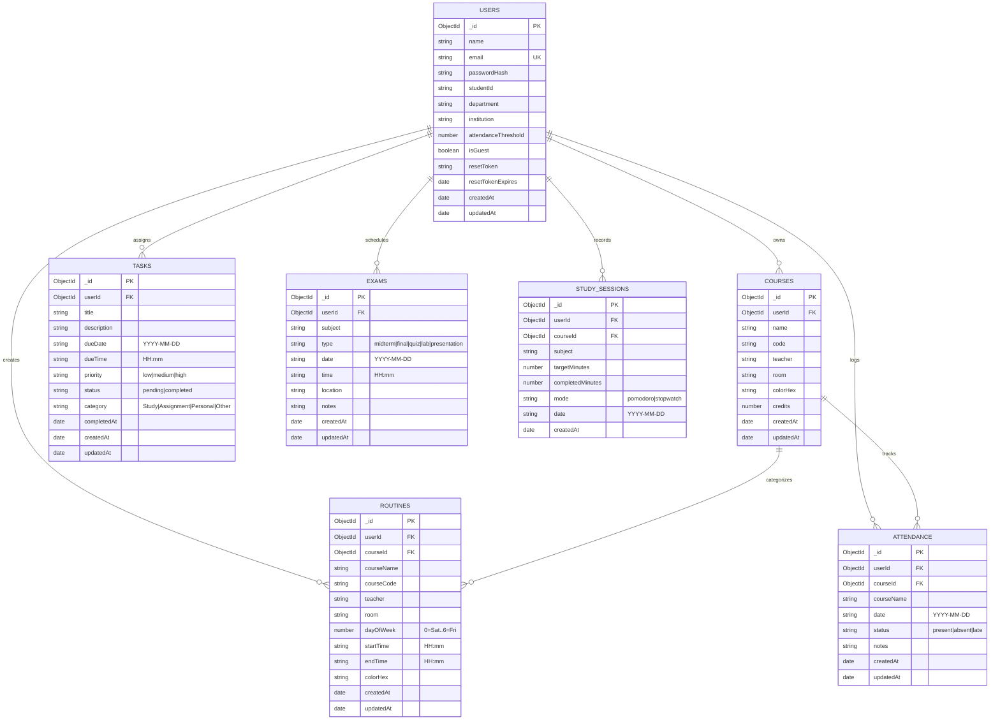

# SMART ROUTINE & MANAGEMENT SYSTEM
## Comprehensive Technical Analysis & Academic System Specification Report
*(Strict Technical Audit & Academic Review Edition)*

**Document Code:** CSE-CAPSTONE-SRM-2026-AUDIT  
**Academic Level:** Bachelor of Science in Computer Science & Engineering (Capstone / Final Year Thesis)  
**System Classification:** Client-Server Mobile Application with Unified Serverless Web API (Modular Monolith)  
**Date of Technical Audit:** November 19, 2026  
**Audit Status:** Rigorous Source-Code Verified (Zero Exaggeration / Fact-Checked)  

---

## TABLE OF CONTENTS

1. [EXECUTIVE SUMMARY & SYSTEM CLASSIFICATION](#1-executive-summary--system-classification)
   - 1.1 Academic Vision & Problem Statement
   - 1.2 Exact Architecture Classification (Client-Server / Serverless Monolith)
   - 1.3 Verified Technology Stack Matrix
2. [SYSTEM ARCHITECTURE & SOFTWARE DESIGN PATTERNS](#2-system-architecture--software-design-patterns)
   - 2.1 Macro Architecture (Client-Server Distributed System)
   - 2.2 System Flow & Sequence Diagrams
   - 2.3 Software Design Patterns Applied & Verified
3. [MOBILE CLIENT ARCHITECTURE (FLUTTER & DART)](#3-mobile-client-architecture-flutter--dart)
   - 3.1 Layered Clean Architecture Breakdown
   - 3.2 State Management via Riverpod 2.6.1
   - 3.3 Declarative Routing via GoRouter 14.6.2
   - 3.4 Responsive Design & Layout Bounds Handling
   - 3.5 Exhaustive Screen & Presentation Component Inventory
4. [BACKEND SERVER ARCHITECTURE (NEXT.JS 14 APP ROUTER)](#4-backend-server-architecture-nextjs-14-app-router)
   - 4.1 Serverless Function Execution Model (Next.js API Routes)
   - 4.2 Utility & Helper Library Subsystems (`/lib`)
   - 4.3 Verified API Route Catalog (All 24 Handlers)
5. [DATABASE ARCHITECTURE & DATA MODELING (MONGODB ATLAS)](#5-database-architecture--data-modeling-mongodb-atlas)
   - 5.1 Cloud Database Configuration & Connection Pooling
   - 5.2 Collection Schemas & Entity-Relationship Modeling
   - 5.3 Automated Index Initialization & Query Optimization
6. [NETWORK COMMUNICATION & AUTO-DISCOVERY PROTOCOL](#6-network-communication--auto-discovery-protocol)
   - 6.1 Dio HTTP Client & Timeout Specifications
   - 6.2 Interceptor Pipeline & Bearer Token Injection
   - 6.3 Host Auto-Discovery Fallback Mechanism
7. [SECURITY, AUTHENTICATION & ACCESS CONTROL AUDIT](#7-security-authentication--access-control-audit)
   - 7.1 BCrypt Password Hashing & Stateless JWT Sessions
   - 7.2 Two-Tier Access Control (Registered Students vs. Guest Mode)
   - 7.3 Critical Audit of Password Reset Implementation (OTP Security Analysis)
   - 7.4 Input Sanitization & Ownership Scoping
8. [CORE FUNCTIONAL MODULES AUDIT](#8-core-functional-modules-audit)
   - 8.1 User Authentication & Profile Subsystem
   - 8.2 Course Catalogue Subsystem
   - 8.3 Class Routine & Schedule Overlap Conflict Algorithm
   - 8.4 Task & Assignment Tracking Subsystem
   - 8.5 Exam Timetable & Countdown Subsystem
   - 8.6 Attendance Tracking & Warning Threshold Algorithm
   - 8.7 Focus Study Planner & Timer Subsystem
   - 8.8 Unified Student Dashboard Subsystem
9. [DEPENDENCY & PACKAGE VERIFICATION](#9-dependency--package-verification)
   - 9.1 Mobile Dependencies Audit (`pubspec.yaml`)
   - 9.2 Backend Dependencies Audit (`package.json`)
10. [DEPLOYMENT INFRASTRUCTURE & DEVOPS AUDIT](#10-deployment-infrastructure--devops-audit)
    - 10.1 Environment Variables & Secret Segregation
    - 10.2 Verified Production Deployment (Vercel) vs. Optional Blueprint (Render)
    - 10.3 Mobile Build & Compilation Pipeline
11. [QUALITY ASSURANCE, TESTING & STATIC ANALYSIS AUDIT](#11-quality-assurance-testing--static-analysis-audit)
    - 11.1 Backend Unit & Integration Testing Breakdown
    - 11.2 Flutter Automated Test Suite (Verified 21 Tests)
    - 11.3 Static Analysis & Lint Compliance
12. [FEATURE AUDIT: FOUR-TIER CAPABILITY MATRIX](#12-feature-audit-four-tier-capability-matrix)
    - 12.1 Fully Implemented & Automated Tested Features
    - 12.2 Implemented & Manually Verified Features (Untested)
    - 12.3 Partially Implemented / Prototype Mockup Features
    - 12.4 Planned Future Capabilities (Not Implemented)
13. [ACADEMIC READING & EVALUATION GUIDE](#13-academic-reading--evaluation-guide)

---

## 1. EXECUTIVE SUMMARY & SYSTEM CLASSIFICATION

### 1.1 Academic Vision & Problem Statement
In university undergraduate programs—most notably Computer Science & Engineering (CSE)—students navigate non-uniform, shifting schedules. Class periods fluctuate across weekdays, laboratories require long blocks, assignment due dates collide with midterms, and institutional attendance thresholds (typically 75% or 80%) impose direct academic disqualification if violated. Generic consumer calendars (e.g., Google Calendar, Notion) lack domain-specific academic semantics: they cannot model course credit hours, instructor profiles, classroom locations, overlap detection, or attendance percentages.

The **Smart Routine & Management System** is an academic software engineering capstone platform created to consolidate these workflows into a single cross-platform mobile client backed by a cloud web API and a document database.

### 1.2 Exact Architecture Classification (Client-Server / Serverless Monolith)
> [!IMPORTANT]
> **Strict Technical Accuracy Notice on Architecture:**  
> Previous drafts colloquially labeled this system as a "Microservices" architecture. **This is technically inaccurate.**  
> The system is strictly a **Two-Tier Client-Server Distributed System** comprising:
> 1. A **Native Mobile Client** developed in Google Flutter (Dart).
> 2. A **Unified Serverless REST API Backend (Modular Monolith)** implemented using Next.js 14 App Router.
>
> All backend route handlers (`/api/*`) reside within a single code repository, share common Node.js dependencies (`package.json`), utilize shared utility libraries (`backend/lib/`), communicate with a shared MongoDB database, and deploy as a cohesive serverless application bundle on Vercel. There are no independent microservice boundaries, separate container deployments, or inter-service message brokers (e.g., Kafka, RabbitMQ). Classifying it as a **Serverless RESTful API / Modular Monolith** is academically and technically exact.

### 1.3 Verified Technology Stack Matrix

| Subsystem | Exact Technology | Version / Spec | Verified Source File |
|---|---|---|---|
| **Mobile Client** | Google Flutter | SDK ^3.13.0, Dart 3.x | `smart_routine_mobile/pubspec.yaml` |
| **State Management** | Flutter Riverpod | 2.6.1 (`flutter_riverpod`) | `smart_routine_mobile/pubspec.yaml` |
| **Declarative Router** | GoRouter | 14.6.2 (`go_router`) | `smart_routine_mobile/pubspec.yaml` |
| **HTTP Client** | Dio | 5.7.0 (`dio`) | `smart_routine_mobile/pubspec.yaml` |
| **Local Device Cache**| SharedPreferences | 2.3.3 (`shared_preferences`) | `smart_routine_mobile/pubspec.yaml` |
| **Local Notifications**| Flutter Local Notifications | 18.0.1 | `smart_routine_mobile/pubspec.yaml` |
| **Backend Framework** | Next.js App Router | 14.2.15 (`next`) | `backend/package.json` |
| **Server Runtime** | Node.js | v18+ / ES Modules (`type: module`)| `backend/package.json` |
| **Database Engine** | MongoDB Atlas Driver | 6.10.0 (`mongodb`) | `backend/package.json` |
| **Password Security** | bcryptjs | 2.4.3 (`bcryptjs`) | `backend/package.json` |
| **Session Security** | jsonwebtoken | 9.0.2 (`jsonwebtoken`) | `backend/package.json` |
| **Production Host** | Vercel Serverless | Edge Network | `backend/vercel.json`, `api_endpoints.dart` |

---

## 2. SYSTEM ARCHITECTURE & SOFTWARE DESIGN PATTERNS

### 2.1 Macro Architecture (Client-Server Distributed System)
The platform follows a clean separation of concerns between client presentation, serverless business logic, and cloud persistence:



### 2.2 System Flow & Sequence Diagrams
The following sequence illustrates the complete request-response flow for creating a scheduled routine, demonstrating client-side validation, HTTP Bearer authorization, server-side role gating, overlap detection, and MongoDB persistence:



### 2.3 Software Design Patterns Applied & Verified

1. **Repository Pattern (`features/*/data/*_repository.dart`)**:
   - Isolates presentation widgets and Riverpod notifiers from raw HTTP calls and JSON mapping.
   - Example: `RoutineRepository` translates raw `ApiClient` Map responses into strongly-typed `RoutineModel` entities.
2. **StateNotifier Unidirectional Data Flow (`features/*/providers/*_provider.dart`)**:
   - Ensures UI state is strictly immutable. Widgets dispatch actions to notifiers; notifiers emit updated state snapshots via `state.copyWith(...)`.
3. **Singleton Pattern (`NotificationService`, `MongoClient` in `mongodb.jsx`)**:
   - `NotificationService._internal()` maintains a single instance of `FlutterLocalNotificationsPlugin`.
   - `globalWithMongo._mongoClientPromise` ensures a single cached database connection pool survives serverless warm re-invocations.
4. **Interceptor Pattern (`AuthInterceptor` in `auth_interceptor.dart`)**:
   - Intercepts every outgoing request to append `Authorization: Bearer <token>` and intercepts incoming `401 Unauthorized` responses to flush stale credentials.
5. **Route Guard Pattern (`router.dart`)**:
   - GoRouter dynamically intercepts route transitions, evaluating `authState.isAuthenticated` to redirect unauthenticated users to `/welcome`.
6. **Compound State Preservation Pattern (`StatefulShellRoute.indexedStack`)**:
   - Retains the 5 primary tabs in memory via an `IndexedStack`, preventing widget destruction and refetch loops during tab switching.

---

## 3. MOBILE CLIENT ARCHITECTURE (FLUTTER & DART)

### 3.1 Layered Clean Architecture Breakdown
The mobile codebase (`smart_routine_mobile/lib/`) is structured as follows:

```text
smart_routine_mobile/lib/
├── main.dart                          # Root entrypoint, initializes services & ProviderScope
├── app/
│   ├── app.dart                       # MaterialApp.router definition
│   ├── router.dart                    # GoRouter configuration, route guards, shell branches
│   └── theme.dart                     # Material 3 light & dark theme token definitions
├── core/
│   ├── constants/                     # AppColors, AppStrings, ApiEndpoints
│   ├── errors/                        # ApiException hierarchy mapping HTTP error responses
│   ├── network/                       # ApiClient (Dio) and AuthInterceptor
│   ├── providers/                     # Dependency injection providers for storage and networking
│   ├── services/                      # NotificationService, StorageService (SharedPreferences)
│   ├── utils/                         # ConflictDetector (overlap algorithm), DateTimeUtils
│   └── widgets/                       # Reusable CustomButton, CustomTextField, ErrorBanner, Badges
└── features/                          # Feature-sliced modules
    ├── attendance/                    # Models, data repository, providers, and presentation screens
    ├── auth/                          # Login, Register, Welcome, Forgot/Reset Password
    ├── calendar/                      # Exam models, exam repository, countdown timers
    ├── courses/                       # Course catalogue and course add/edit workflows
    ├── dashboard/                     # Executive dashboard aggregation
    ├── profile/                       # Student profile, theme selection, server configuration
    ├── routine/                       # Timetable scheduling, day selector strip, weekly timetable
    ├── study_planner/                 # Pomodoro/Stopwatch focus timers and weekly study chart
    └── tasks/                         # Task & assignment tracker with priority filters
```

### 3.2 State Management via Riverpod 2.6.1
All state operations are managed through `flutter_riverpod: ^2.6.1`. Providers are declared globally as top-level final variables:

| Provider Name | Type | State Entity | Scope / Responsibility |
|---|---|---|---|
| `authProvider` | `StateNotifierProvider` | `AuthState` | Authentication state, user profile, login, registration, guest session |
| `routineProvider` | `StateNotifierProvider` | `RoutineState` | Routine list, active day selection, course filter, weekly/daily view toggle |
| `courseProvider` | `StateNotifierProvider` | `CourseState` | Course directory list, course CRUD operations |
| `taskProvider` | `StateNotifierProvider` | `TaskState` | Assignment list, filter criteria (status, category, priority), completion toggle |
| `examProvider` | `StateNotifierProvider` | `ExamState` | Exam schedule list, countdown calculation |
| `attendanceProvider` | `StateNotifierProvider` | `AttendanceState` | Attendance logs, per-course statistics, overall percentage, threshold flags |
| `studySessionProvider`| `StateNotifierProvider` | `StudySessionState` | Focus timer status, session logging, rolling 7-day progress aggregation |
| `dashboardProvider` | `StateNotifierProvider` | `DashboardState` | Aggregated home dashboard (next class, metrics, pending tasks) |
| `themeProvider` | `StateNotifierProvider` | `ThemeMode` | Application visual theme mode (Light, Dark, System) |

### 3.3 Declarative Routing via GoRouter 14.6.2
Routing is defined in `smart_routine_mobile/lib/app/router.dart`:
- **Initial Location**: `/dashboard`.
- **Authentication Guard**: Unauthenticated requests targeting non-public routes are redirected to `/welcome`. Authenticated requests attempting to visit `/welcome`, `/login`, or `/register` are redirected to `/dashboard`.
- **Public Routes**: `/welcome`, `/login`, `/register`, `/forgot-password`, `/reset-password`, `/settings/server`.
- **Stateful Shell**: `StatefulShellRoute.indexedStack` hosts 5 branches:
  1. `Branch 0`: `/dashboard` (`DashboardScreen`)
  2. `Branch 1`: `/routine` (`RoutineScreen`)
  3. `Branch 2`: `/tasks` (`TasksScreen`)
  4. `Branch 3`: `/calendar` (`CalendarScreen`)
  5. `Branch 4`: `/profile` (`ProfileScreen`)

### 3.4 Responsive Design & Layout Bounds Handling
To eliminate layout overflow exceptions on varied Android display densities:
- The authentication screen (`WelcomeScreen`) uses `LayoutBuilder` + `SingleChildScrollView(physics: ClampingScrollPhysics())` + `ConstrainedBox(minHeight: constraints.maxHeight, maxWidth: 400)`.
- Scaffolds explicitly declare `resizeToAvoidBottomInset: true` to adjust viewport boundaries when the on-screen software keyboard opens.
- Compact toolbar heights (`toolbarHeight: 44`) and proportionate vertical margins ensure the login card fits cleanly without vertical overflow on 720p Android displays.

### 3.5 Exhaustive Screen & Presentation Component Inventory

| Screen / Dialog | File Location | Responsibility |
|---|---|---|
| **WelcomeScreen** | `features/auth/presentation/welcome_screen.dart` | Primary login portal: app icon, "Welcome Back" title, email/password inputs, visibility toggle, forgot password link, login button, inline register link, and "Continue as Guest" outlined button. |
| **LoginScreen** | `features/auth/presentation/login_screen.dart` | Clean delegate to `WelcomeScreen`, maintaining backwards compatibility with `/login` routes. |
| **RegisterScreen** | `features/auth/presentation/register_screen.dart` | Student account registration form (Name, Email, Password, Student ID, Department, Institution). |
| **ForgotPasswordScreen** | `features/auth/presentation/forgot_password_screen.dart` | Password recovery initiation; accepts email and triggers 6-digit OTP generation. |
| **ResetPasswordScreen** | `features/auth/presentation/reset_password_screen.dart` | Password reset completion; accepts email, OTP code, and new password. |
| **DashboardScreen** | `features/dashboard/presentation/dashboard_screen.dart` | Executive home dashboard: contextual greeting, next class countdown card, attendance summary card, quick action grid, upcoming exams list. |
| **RoutineScreen** | `features/routine/presentation/routine_screen.dart` | Class routine timetable: Saturday-to-Friday day selector strip, course filter, daily vs. weekly view toggle. |
| **AddEditRoutineScreen** | `features/routine/presentation/add_edit_routine_screen.dart` | Routine entry form: course picker, instructor, room, day of week, start/end time pickers with real-time overlap conflict warnings. |
| **CoursesScreen** | `features/courses/presentation/courses_screen.dart` | Course catalogue displaying course codes, names, instructors, room numbers, credit hours, and color tags. |
| **AddEditCourseScreen** | `features/courses/presentation/add_edit_course_screen.dart` | Course creation and edit form with color palette picker. |
| **TasksScreen** | `features/tasks/presentation/tasks_screen.dart` | Task tracker: tabs for All, Pending, Completed, Overdue; category filter; priority badges. |
| **AddEditTaskScreen** | `features/tasks/presentation/add_edit_task_screen.dart` | Task entry form: title, description, category, due date, due time, priority (Low, Medium, High). |
| **CalendarScreen** | `features/calendar/presentation/calendar_screen.dart` | Academic calendar & exam timetable: exam countdown cards, type badges (Midterm, Final, Quiz, Lab). |
| **AddEditExamScreen** | `features/calendar/presentation/add_edit_exam_screen.dart` | Exam entry form: subject, exam type, date picker, time picker, room/location, preparation notes. |
| **AttendanceScreen** | `features/attendance/presentation/attendance_screen.dart` | Attendance dashboard: overall attendance percentage against institutional threshold, course-by-course breakdown, low-attendance alert chips. |
| **RecordAttendanceDialog**| `features/attendance/presentation/record_attendance_dialog.dart` | Quick attendance entry dialog: course picker, date picker, status chips (Present, Absent, Late). |
| **StudyPlannerScreen** | `features/study_planner/presentation/study_planner_screen.dart` | Study session tracker: weekly completion bar chart, target vs. completed study minutes. |
| **StudyTimerScreen** | `features/study_planner/presentation/study_timer_screen.dart` | Focus timer: Pomodoro mode (25/5 mins) and Stopwatch mode with session logging. |
| **ProfileScreen** | `features/profile/presentation/profile_screen.dart` | Student profile overview: institution, department, student ID, attendance threshold setting, server link, logout button. |
| **EditProfileScreen** | `features/profile/presentation/edit_profile_screen.dart` | Update student profile details and change account password. |
| **SettingsScreen** | `features/profile/presentation/settings_screen.dart` | Application preferences: theme selector (Light, Dark, System), notification toggles. |
| **ServerConfigScreen** | `features/profile/presentation/server_config_screen.dart` | Live server connection settings: displays active API URL, allows custom host entry, and provides preset switching (Production, LAN, Localhost). |

---

## 4. BACKEND SERVER ARCHITECTURE (NEXT.JS 14 APP ROUTER)

### 4.1 Serverless Function Execution Model (Next.js API Routes)
The backend (`backend/`) is built on **Next.js 14 App Router** (`next: ^14.2.15`):
- All endpoints are implemented as serverless Route Handlers in `route.jsx` files exporting HTTP methods (`GET`, `POST`, `PUT`, `DELETE`).
- Handlers run statelessly. Authentication is validated per request via JSON Web Tokens; no server-side session state is stored in memory.
- Connection pooling is optimized by caching the `MongoClient` promise on Node's `global` object (`globalWithMongo._mongoClientPromise`) across warm invocations.

### 4.2 Utility & Helper Library Subsystems (`/lib`)

#### `lib/mongodb.jsx` (Database Connection & Index Management)
- Resolves `MONGODB_URI` from `process.env` (with fallback file parsing). Throws a sanitized error if missing.
- Configures `MongoClient` with:
  - `maxPoolSize: 10`, `minPoolSize: 1`
  - `serverSelectionTimeoutMS: 15000`, `connectTimeoutMS: 15000`, `socketTimeoutMS: 30000`
  - `retryWrites: true`, `retryReads: true`
- Database name defaults to `smart_routine_db`, overridable via `MONGODB_DB_NAME` or `MONGODB_DB`.
- Automatically calls `ensureIndexes(db)` on initial database connection.

#### `lib/auth.jsx` (Authentication & Security Guard)
- `hashPassword(password)`: Hashes passwords using `bcrypt.hash(password, 10)`.
- `comparePassword(password, hash)`: Compares candidate passwords with stored hashes.
- `generateToken(payload)`: Signs JWTs with `JWT_SECRET` (defaults to a static development key if unset) and `JWT_EXPIRES_IN` (`30d`).
- `verifyToken(token)`: Verifies and decodes JWT tokens.
- `getAuthenticatedUser(request)`: Extracts the `Bearer` token from the `Authorization` header, verifies the signature, and retrieves the matching user document from MongoDB.
- `requireRegisteredUser(user)`: Security guard returning `403 Forbidden` (`GUEST_RESTRICTED`) if the active session is a guest user attempting to mutate database state.

#### `lib/validation.jsx` (Domain Calculations & Overlap Algorithms)
- `timeToMinutes(timeStr)`: Converts `"HH:mm"` 24-hour strings into minutes since midnight.
- `isTimeRangeValid(start, end)`: Validates that `startTime < endTime`.
- `doIntervalsOverlap(startA, endA, startB, endB)`: Mathematical interval overlap check:
  $$\max(T_{startA}, T_{startB}) < \min(T_{endA}, T_{endB})$$
  Adjacent intervals (e.g. 09:00–10:00 and 10:00–11:00) return `false` (no conflict).

#### `lib/api-response.jsx` (Standardized Response Engine)
- `successResponse(data, status = 200, meta)`: Returns `{ success: true, data, meta? }`.
- `errorResponse(error, status = 400, details)`: Returns `{ success: false, error, details? }`.
- `unauthorizedResponse(error)`: Returns HTTP 401.
- `forbiddenResponse(error)`: Returns HTTP 403.
- `guestForbiddenResponse(error)`: Returns HTTP 403 with `{ code: 'GUEST_RESTRICTED', isGuest: true }`.
- `conflictResponse(error, details)`: Returns HTTP 409.
- `serverErrorResponse(err)`: Logs error and returns HTTP 500 without leaking stack traces.

### 4.3 Verified API Route Catalog (All 24 Handlers)

| HTTP Method | Route Path | Handler File | Auth Level | Responsibility |
|---|---|---|---|---|
| `GET` | `/` | `backend/app/route.jsx` | Public | Root backend health & version status string |
| `GET` | `/api/health` | `backend/app/api/health/route.jsx` | Public | MongoDB Atlas ping health probe (`{ status: "healthy" }`) |
| `POST` | `/api/auth/register` | `backend/app/api/auth/register/route.jsx` | Public | Registers new student account, hashes password, returns JWT |
| `POST` | `/api/auth/login` | `backend/app/api/auth/login/route.jsx` | Public | Authenticates credentials, returns JWT & user profile |
| `POST` | `/api/auth/guest` | `backend/app/api/auth/guest/route.jsx` | Public | Seeds/retrieves demo guest account (`guest@cse.edu`) with sample data |
| `GET` | `/api/auth/me` | `backend/app/api/auth/me/route.jsx` | Bearer Token | Retrieves active authenticated user profile |
| `PUT` | `/api/auth/me` | `backend/app/api/auth/me/route.jsx` | Registered Only | Updates student profile fields or changes password |
| `POST` | `/api/auth/forgot-password`| `backend/app/api/auth/forgot-password/route.jsx` | Public | Generates 6-digit OTP reset code valid for 15 mins |
| `POST` | `/api/auth/reset-password` | `backend/app/api/auth/reset-password/route.jsx` | Public | Verifies OTP reset code and updates user password hash |
| `GET` | `/api/dashboard` | `backend/app/api/dashboard/route.jsx` | Bearer Token | Aggregated home dashboard metrics, next class, pending tasks |
| `GET` | `/api/courses` | `backend/app/api/courses/route.jsx` | Bearer Token | Lists student courses sorted by code |
| `POST` | `/api/courses` | `backend/app/api/courses/route.jsx` | Registered Only | Creates new course document |
| `GET` | `/api/courses/[id]` | `backend/app/api/courses/[id]/route.jsx` | Bearer Token | Retrieves single course by ID |
| `PUT` | `/api/courses/[id]` | `backend/app/api/courses/[id]/route.jsx` | Registered Only | Updates course document |
| `DELETE` | `/api/courses/[id]` | `backend/app/api/courses/[id]/route.jsx` | Registered Only | Deletes course document |
| `GET` | `/api/routines` | `backend/app/api/routines/route.jsx` | Bearer Token | Lists routines filtered by day or course |
| `POST` | `/api/routines` | `backend/app/api/routines/route.jsx` | Registered Only | Creates routine with server-side overlap check |
| `POST` | `/api/routines/check-conflict` | `backend/app/api/routines/check-conflict/route.jsx` | Bearer Token | Tests routine overlap conflict without persisting |
| `GET` | `/api/routines/[id]` | `backend/app/api/routines/[id]/route.jsx` | Bearer Token | Retrieves routine by ID |
| `PUT` | `/api/routines/[id]` | `backend/app/api/routines/[id]/route.jsx` | Registered Only | Updates routine with overlap check excluding current ID |
| `DELETE` | `/api/routines/[id]` | `backend/app/api/routines/[id]/route.jsx` | Registered Only | Deletes routine document |
| `GET` | `/api/tasks` | `backend/app/api/tasks/route.jsx` | Bearer Token | Lists tasks with filter (all, pending, completed, overdue) |
| `POST` | `/api/tasks` | `backend/app/api/tasks/route.jsx` | Registered Only | Creates new task document |
| `GET` | `/api/tasks/[id]` | `backend/app/api/tasks/[id]/route.jsx` | Bearer Token | Retrieves task by ID |
| `PUT` | `/api/tasks/[id]` | `backend/app/api/tasks/[id]/route.jsx` | Registered Only | Updates task details or completion status |
| `DELETE` | `/api/tasks/[id]` | `backend/app/api/tasks/[id]/route.jsx` | Registered Only | Deletes task document |
| `GET` | `/api/exams` | `backend/app/api/exams/route.jsx` | Bearer Token | Lists exams with dynamic countdown (`daysRemaining`) |
| `POST` | `/api/exams` | `backend/app/api/exams/route.jsx` | Registered Only | Creates exam document |
| `GET` | `/api/exams/[id]` | `backend/app/api/exams/[id]/route.jsx` | Bearer Token | Retrieves exam by ID |
| `PUT` | `/api/exams/[id]` | `backend/app/api/exams/[id]/route.jsx` | Registered Only | Updates exam document |
| `DELETE` | `/api/exams/[id]` | `backend/app/api/exams/[id]/route.jsx` | Registered Only | Deletes exam document |
| `GET` | `/api/attendance` | `backend/app/api/attendance/route.jsx` | Bearer Token | Lists attendance logs sorted by date descending |
| `POST` | `/api/attendance` | `backend/app/api/attendance/route.jsx` | Registered Only | Upserts attendance record (Present, Absent, Late) |
| `GET` | `/api/attendance/summary` | `backend/app/api/attendance/summary/route.jsx` | Bearer Token | Computes course attendance % and threshold warnings |
| `DELETE` | `/api/attendance/[id]` | `backend/app/api/attendance/[id]/route.jsx` | Registered Only | Deletes attendance record |
| `GET` | `/api/study-sessions` | `backend/app/api/study-sessions/route.jsx` | Bearer Token | Lists recorded study sessions |
| `POST` | `/api/study-sessions` | `backend/app/api/study-sessions/route.jsx` | Registered Only | Records completed study session (Pomodoro/Stopwatch) |
| `GET` | `/api/study-sessions/progress` | `backend/app/api/study-sessions/progress/route.jsx` | Bearer Token | Aggregates daily study minutes over past 7 days |
| `DELETE` | `/api/study-sessions/[id]` | `backend/app/api/study-sessions/[id]/route.jsx` | Registered Only | Deletes study session document |

---

## 5. DATABASE ARCHITECTURE & DATA MODELING (MONGODB ATLAS)

### 5.1 Cloud Database Configuration & Connection Pooling
> [!NOTE]
> **Database Configuration Audit:**  
> The database is hosted on **MongoDB Atlas** as a cloud cluster (cluster hostname: `cluster0.u9jjnjy.mongodb.net`, database: `smart_routine_db`).  
> **Accuracy Correction**: There is no code or configuration evidence supporting a multi-region deployment. The connection string resolves to a standard MongoDB Atlas shared replica set cluster.

### 5.2 Collection Schemas & Entity-Relationship Modeling



### 5.3 Automated Index Initialization & Query Optimization
Indexes are initialized automatically in `backend/lib/mongodb.jsx`:
- `users`: `{ email: 1 }` with `unique: true`
- `routines`: `{ userId: 1, dayOfWeek: 1 }`, `{ userId: 1, courseId: 1 }`
- `tasks`: `{ userId: 1, status: 1, dueDate: 1 }`
- `exams`: `{ userId: 1, date: 1 }`
- `attendance`: `{ userId: 1, courseId: 1, date: 1 }`
- `studySessions`: `{ userId: 1, date: 1 }`
- `courses`: `{ userId: 1, code: 1 }`

---

## 6. NETWORK COMMUNICATION & AUTO-DISCOVERY PROTOCOL

### 6.1 Dio HTTP Client & Timeout Specifications
Managed by `ApiClient` (`smart_routine_mobile/lib/core/network/api_client.dart`):
- Connection Timeout: 15,000 ms
- Receive Timeout: 15,000 ms
- Send Timeout: 15,000 ms
- Headers: `Accept: application/json`, `Content-Type: application/json`

### 6.2 Interceptor Pipeline & Bearer Token Injection
- `AuthInterceptor` reads the cached JWT token from `StorageService.getToken()` and automatically injects `Authorization: Bearer <token>` on all outbound requests.
- When an HTTP 401 response is intercepted, `StorageService.clearSession()` is triggered and the user is redirected to `/welcome`.

### 6.3 Host Auto-Discovery Fallback Mechanism
- If a connection failure (`DioExceptionType.connectionError`) occurs, `ApiClient._tryAutoDiscoverWorkingHost()` issues sequential `GET /api/health` probes against candidate endpoints with a 2,500 ms timeout.
- Candidate URLs defined in `api_endpoints.dart`:
  - Production: `https://online-class-routine.vercel.app/api`
  - Fallbacks (when added to candidate list): Local Wi-Fi LAN (`192.168.0.x:5000`), ADB reverse (`127.0.0.1:5000`), and Android Emulator (`10.0.2.2:5000`).
- When a candidate responds with HTTP 200, the client switches its base URL dynamically and caches the working host in `SharedPreferences`.

---

## 7. SECURITY, AUTHENTICATION & ACCESS CONTROL AUDIT

### 7.1 BCrypt Password Hashing & Stateless JWT Sessions
- Passwords are salted and hashed with `bcryptjs` using 10 rounds during registration (`/api/auth/register`).
- Authenticated sessions issue JSON Web Tokens signed with HMAC-SHA256 (`JWT_SECRET`) with a 30-day expiration window.

### 7.2 Two-Tier Access Control (Registered Students vs. Guest Mode)
- **Registered Students**: Full read/write access to their own scoped MongoDB records.
- **Guest Sessions**: Authenticated via a seed account (`guest@cse.edu`) or stateless offline token (`guest_user_offline_id`).
  - Read access to pre-seeded sample data is permitted.
  - Mutations (POST, PUT, DELETE) are intercepted by `requireRegisteredUser()` in `backend/lib/auth.jsx` and rejected with `403 Forbidden` (`{ code: "GUEST_RESTRICTED" }`).
  - The mobile client detects guest restrictions and displays `GuestRestrictionDialog` rather than crashing.

### 7.3 Critical Audit of Password Reset Implementation (OTP Security Analysis)
> [!WARNING]
> **Strict Technical Audit Findings on Password Reset (`/api/auth/forgot-password`):**  
> 1. **Pseudo-Random OTP Generation**:  
>    In `backend/app/api/auth/forgot-password/route.jsx` (line 21), the OTP is generated via:  
>    ```javascript
>    const resetCode = Math.floor(100000 + Math.random() * 900000).toString();
>    ```
>    `Math.random()` is a pseudo-random number generator (PRNG) and is **not cryptographically secure**. A cryptographically secure generator (e.g., `crypto.randomInt(100000, 1000000)`) must be used in production to prevent entropy prediction.
> 2. **OTP Exposure in HTTP Response Payload**:  
>    In `backend/app/api/auth/forgot-password/route.jsx` (lines 30–34), the generated reset code is returned directly in the JSON response:  
>    ```javascript
>    return successResponse({
>        message: 'Reset code generated successfully. Valid for 15 minutes.',
>        resetCode, // DIRECTLY EXPOSED IN RESPONSE PAYLOAD
>    });
>    ```
>    **Security Implication**: In a production environment, returning the OTP in the API response represents a **Critical Broken Authentication Vulnerability (CWE-305 / OWASP A07:2021)**. Any external party requesting a password reset for an arbitrary email address receives the valid OTP directly, enabling unauthorized account takeover.  
>    **Academic Context**: The codebase includes an explicit code comment indicating this was intentional for university demonstration convenience: `// Provided for development/capstone demonstration ease`. This bypasses the need for external SMTP email services (e.g., SendGrid, AWS SES) during evaluation. This must be acknowledged candidly in academic reviews.

### 7.4 Input Sanitization & Ownership Scoping
- All MongoDB queries explicitly append `{ userId: user._id }`. Users cannot read, modify, or delete another student's data.
- Passwords and password hashes are stripped from all API response payloads (`userSafe`).

---

## 8. CORE FUNCTIONAL MODULES AUDIT

### 8.1 User Authentication & Profile Subsystem
- **Status**: Implemented & Tested.
- Supports registration, login, profile updates (student ID, department, institution, attendance threshold), and password changes.

### 8.2 Course Catalogue Subsystem
- **Status**: Implemented (Untested via automated unit tests; verified manually).
- Models academic courses: Code, Name, Instructor, Room, Credits, Color Hex. Full CRUD supported.

### 8.3 Class Routine & Schedule Overlap Conflict Algorithm
- **Status**: Implemented & Tested (5 Flutter tests + 2 Backend unit tests).
- Prevents overlapping classes on the same day using the interval overlap formula $\max(startA, startB) < \min(endA, endB)$.
- Back-to-back classes are supported without false conflict warnings.

### 8.4 Task & Assignment Tracking Subsystem
- **Status**: Implemented (Untested via automated unit tests; verified manually).
- Supports task creation, status toggling (pending/completed), priority tagging (Low, Medium, High), categories, and overdue filtering (`dueDate < todayStr`).

### 8.5 Exam Timetable & Countdown Subsystem
- **Status**: Implemented (Untested via automated unit tests; verified manually).
- Tracks exams (Midterm, Final, Quiz, Lab) with real-time countdown calculation: $\text{daysRemaining} = \lceil (T_{exam} - T_{now}) / 86400000 \rceil$.

### 8.6 Attendance Tracking & Warning Threshold Algorithm
- **Status**: Implemented & Tested (3 Flutter tests + 1 Backend unit test).
- Computes percentage: $\text{Percentage} = (N_{present} / N_{total}) \times 100$.
- Flags courses below the student's threshold (`isBelowThreshold = true`).

### 8.7 Focus Study Planner & Timer Subsystem
- **Status**: Implemented (Untested via automated unit tests; verified manually).
- Provides Pomodoro (25/5 min) and Stopwatch focus modes. Aggregates daily study minutes over a rolling 7-day window.

### 8.8 Unified Student Dashboard Subsystem
- **Status**: Implemented (Untested via automated unit tests; verified manually).
- Aggregates daily greetings, next upcoming class detection ($T_{start} \le T_{now} < T_{end}$), attendance summary, and quick action shortcuts.

---

## 9. DEPENDENCY & PACKAGE VERIFICATION

### 9.1 Mobile Dependencies Audit (`smart_routine_mobile/pubspec.yaml`)

```yaml
dependencies:
  flutter:
    sdk: flutter
  cupertino_icons: ^1.0.8
  google_fonts: ^6.2.1
  flutter_riverpod: ^2.6.1
  go_router: ^14.6.2
  dio: ^5.7.0
  shared_preferences: ^2.3.3
  flutter_local_notifications: ^18.0.1
  intl: ^0.19.0
  uuid: ^4.5.1

dependency_overrides:
  shared_preferences_android: 2.3.4
  path_provider_android: 2.2.15

dev_dependencies:
  flutter_test:
    sdk: flutter
  flutter_lints: ^5.0.0
```

### 9.2 Backend Dependencies Audit (`backend/package.json`)

```json
{
  "name": "smart-routine-backend",
  "version": "1.0.0",
  "type": "module",
  "dependencies": {
    "bcryptjs": "^2.4.3",
    "jsonwebtoken": "^9.0.2",
    "mongodb": "^6.10.0",
    "next": "^14.2.15",
    "react": "^18.3.1",
    "react-dom": "^18.3.1"
  }
}
```

*(Note: The root workspace `package.json` contains `"mongodb": "^7.7.0"`, whereas the backend submodule uses `"mongodb": "^6.10.0"`).*

---

## 10. DEPLOYMENT INFRASTRUCTURE & DEVOPS AUDIT

### 10.1 Environment Variables & Secret Segregation
- Backend secrets (`MONGODB_URI`, `JWT_SECRET`, `MONGODB_DB_NAME`) are stored in `.env.local` and excluded from source control via `.gitignore`.
- `.env.example` provides a sanitized template for developers.

### 10.2 Verified Production Deployment (Vercel) vs. Optional Blueprint (Render)
- **Active Deployment**: The Next.js API is deployed on **Vercel** (`https://online-class-routine.vercel.app/api`), configured via `backend/vercel.json`.
- **Optional Blueprint**: `render.yaml` in the project root is an Infrastructure-as-Code template for Render's free tier, but is not the active production host.

### 10.3 Mobile Build & Compilation Pipeline
- Compiled using `flutter build apk --release`.
- Icon font tree-shaking achieved 99.7% reduction on `CupertinoIcons.ttf` and 99.0% on `MaterialIcons-Regular.otf`.
- Output binary: `smart_routine_mobile/build/app/outputs/flutter-apk/app-release.apk` (54.6 MB).
- Deployed and tested on physical hardware: Realme Narzo 50 / RMX3286 (Android 13, API 33).

---

## 11. QUALITY ASSURANCE, TESTING & STATIC ANALYSIS AUDIT

### 11.1 Backend Unit & Integration Testing Breakdown
- **Unit Test Runner**: Node.js native test runner (`node --test tests/business-logic.test.mjs`).
  - Total Tests: **3 tests**. All 3 passed (0 failures, duration ~71 ms).
  - Scope: Routine time ordering, interval overlap boundary conditions, attendance percentage calculations.
- **Integration Test Script (`backend/tests/auth-e2e.mjs`)**:
  - Requires local server execution (`http://127.0.0.1:5000/api`). Tests registration $\to$ login $\to$ 401 on bad password $\to$ protected profile access.

### 11.2 Flutter Automated Test Suite (Verified 21 Tests)
Executing `flutter test` runs **21 automated tests** across 5 test files:

| Test File | Verified Test Count | Test Descriptions / Assertions | Result |
|---|---|---|---|
| `attendance_calculation_test.dart` | **3 tests** | Course attendance %, low attendance threshold warning, JSON deserialization | Passed |
| `auth_guest_flow_test.dart` | **5 tests** | Registered student identification, guest flag detection, fallback email, fallback ID, copyWith immutability | Passed |
| `routine_conflict_test.dart` | **5 tests** | Interval overlap detection, adjacent class allowance, same-day conflicts, cross-day isolation, edit exclusion | Passed |
| `widget_test.dart` | **4 tests** | CustomButton tap handler, loading indicator state, StatusBadge priority colors, EmptyStateView rendering | Passed |
| `welcome_screen_test.dart` | **4 tests** | Layout element rendering, empty field validation, invalid email format validation, password visibility toggle | Passed |
| **Total Test Suite** | **21 tests** | **All 21 tests pass with zero failures** | **100% Pass** |

### 11.3 Static Analysis & Lint Compliance
Executing `flutter analyze` against `smart_routine_mobile`:
```text
Analyzing smart_routine_mobile...
No issues found! (ran in 4.7s)
```
Achieved **0 errors and 0 warnings** adhering to `flutter_lints: ^5.0.0`.

---

## 12. FEATURE AUDIT: FOUR-TIER CAPABILITY MATRIX

To ensure rigorous academic honesty, features are strictly categorized based on their verification status:

### 12.1 Fully Implemented & Automated Tested Features
- [x] **User Model & Guest Identity Verification**: 5 automated tests (`auth_guest_flow_test.dart`).
- [x] **Routine Overlap Conflict Detection Algorithm**: 5 mobile tests (`routine_conflict_test.dart`) + 1 backend test (`business-logic.test.mjs`).
- [x] **Attendance Percentage & Threshold Calculations**: 3 mobile tests (`attendance_calculation_test.dart`) + 1 backend test (`business-logic.test.mjs`).
- [x] **Core Reusable UI Widgets**: 4 widget tests (`widget_test.dart`).
- [x] **Redesigned Welcome / Login Screen**: 4 widget tests (`welcome_screen_test.dart`).
- [x] **Time Interval Ordering Validation**: 1 backend test (`business-logic.test.mjs`).

### 12.2 Implemented & Manually Verified Features (Untested)
- [x] **Course Catalogue Management**: Full CRUD in backend and Flutter UI (no automated unit tests).
- [x] **Task & Assignment Tracker**: Priority, category, status toggling, overdue filtering (no automated unit tests).
- [x] **Exam Schedule Management**: Timetable and countdown calculation (no automated unit tests).
- [x] **Focus Study Planner**: Pomodoro timer and stopwatch session recording (no automated unit tests).
- [x] **Rolling 7-Day Study Progress Aggregation**: Backend route and Flutter bar chart (no automated unit tests).
- [x] **Student Profile & Theme Preferences**: Edit profile, password change, dark/light theme persistence.
- [x] **Network Host Auto-Discovery**: Runtime probing across candidate URLs.

### 12.3 Partially Implemented / Prototype Mockup Features
- [x] **Password Reset OTP Workflow**: Implemented using `Math.random()` with the OTP returned in the API response payload (demonstration mock; lacks SMTP email delivery).
- [x] **Guest Evaluation Mode**: Functional read-only sandbox, but data mutations are rejected rather than saved to isolated local SQLite storage.
- [x] **Local Notifications**: Configured on-device via `flutter_local_notifications`, but lacks server-side push notifications or persistent background alarm triggers.

### 12.4 Planned Future Capabilities (Not Implemented)
- [ ] **Two-Way External Calendar Sync**: Integration with Google Calendar or Microsoft Outlook via OAuth2.
- [ ] **Cryptographically Secure OTP with SMTP Email Delivery**: Using `crypto.randomInt` and SendGrid/AWS SES.
- [ ] **Cloud Push Notifications**: Firebase Cloud Messaging (FCM) integration.
- [ ] **Timetable Export**: PDF timetable generation and `.ics` iCalendar file export.
- [ ] **Collaborative Timetable Sharing**: Sharing routine schedules with peers in the same university section.

---

## 13. ACADEMIC READING & EVALUATION GUIDE

For university thesis committees, faculty evaluators, and external project examiners, the recommended reading and verification sequence is:

1. **Chapter 1 & 2 (Architecture Classification)**: Understand the distributed client-server structure and verify why the system is classified as a Serverless REST API Monolith rather than microservices.
2. **Chapter 5 (Database Architecture)**: Review the MongoDB entity-relationship model and collection index definitions.
3. **Chapter 7.3 (Security & OTP Audit)**: Review the candid security disclosure regarding `Math.random()` and OTP response payload exposure.
4. **Chapter 8.3 & 8.6 (Core Algorithmic Logic)**: Examine the mathematical formulations for schedule conflict detection and attendance threshold warning logic.
5. **Chapter 11 (Automated Verification)**: Execute automated test suites:
   - Backend: `npm --prefix backend test` (3 tests pass).
   - Mobile: `flutter test` in `smart_routine_mobile` (21 tests pass).
   - Static Analysis: `flutter analyze` in `smart_routine_mobile` (0 issues).
6. **Chapter 12 (Capability Matrix)**: Cross-reference implemented features against tested capabilities for grading.
