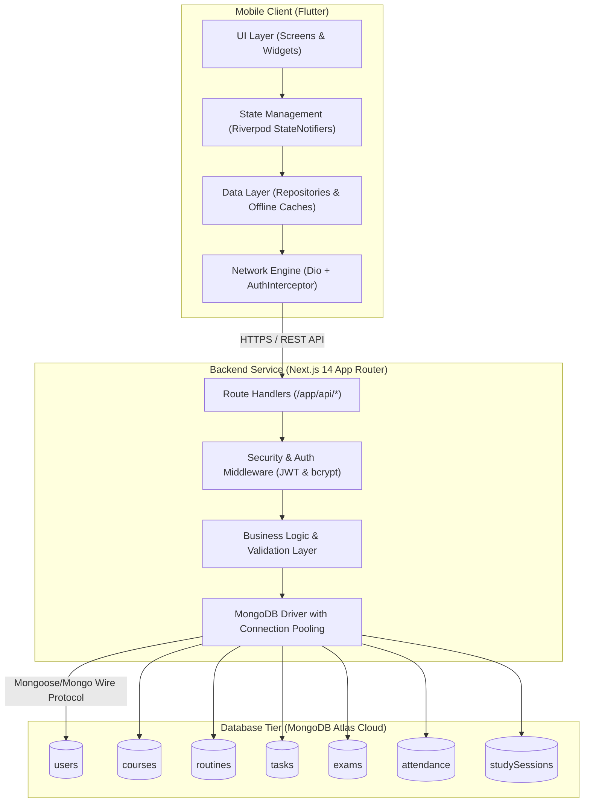
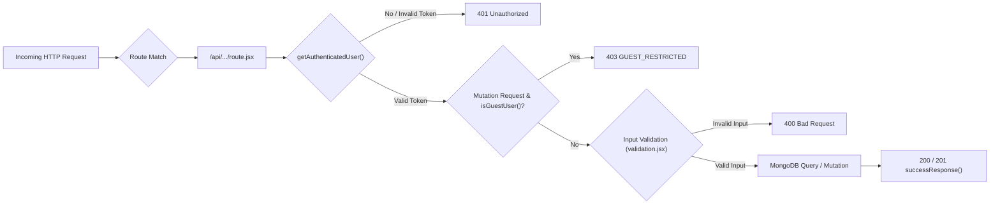
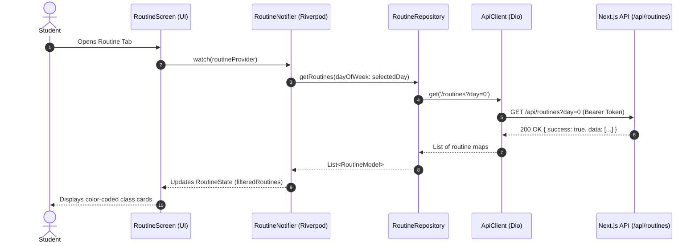
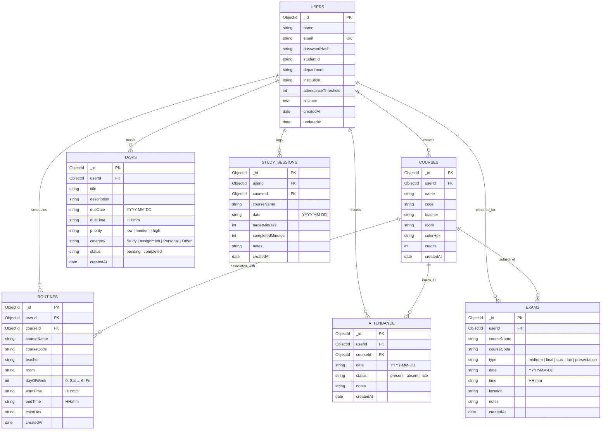
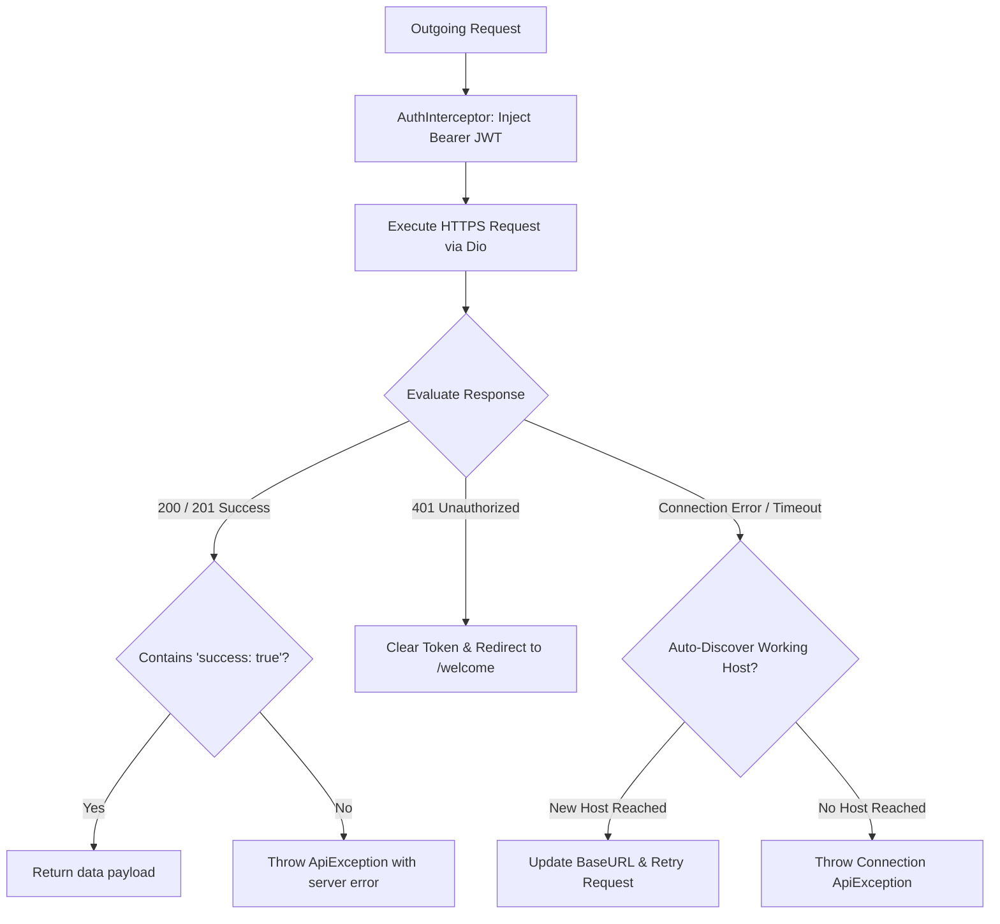
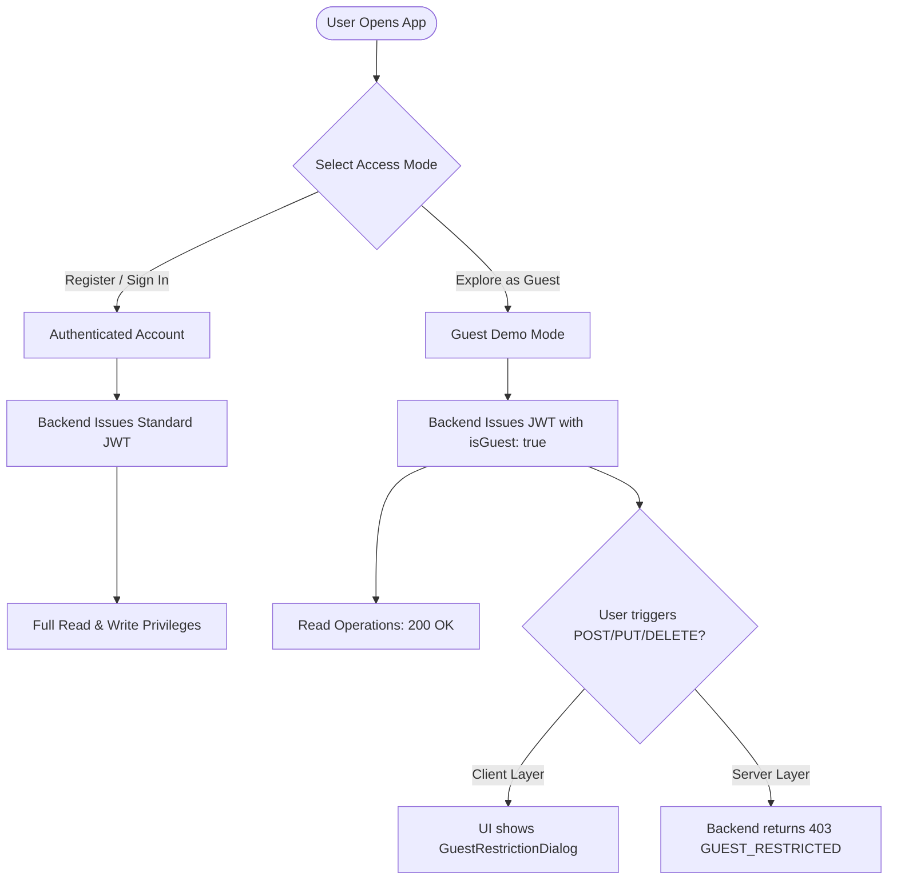
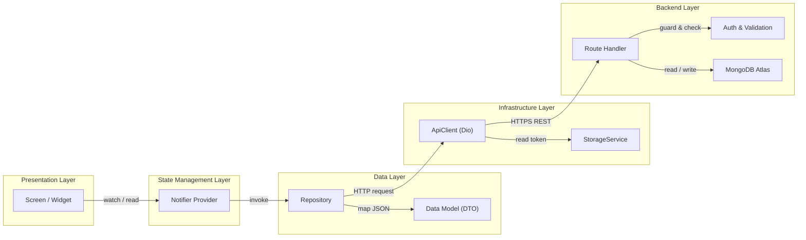
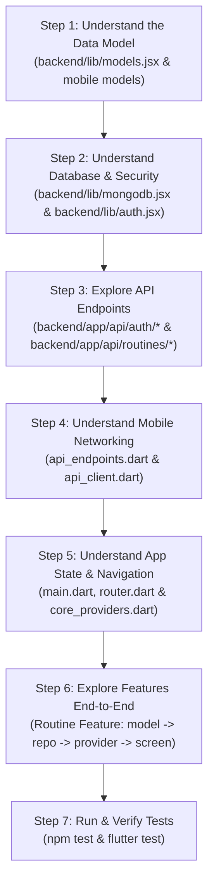

# Smart Routine & Management Application — Complete Technical Documentation

> **Document Version:** 1.0.0  
> **Last Updated:** November 2026  
> **Target Audience:** Developers, DevOps Engineers, Architects, and New Contributors  
> **Scope:** Full-stack analysis covering Backend (Next.js 14 / Node.js / MongoDB Atlas) and Mobile (Flutter / Riverpod / Android / iOS).

---

## Table of Contents

1. [Project Overview & System Definition](#1-project-overview--system-definition)
2. [Complete Project Structure](#2-complete-project-structure)
3. [Folder-by-Folder Detailed Breakdown](#3-folder-by-folder-detailed-breakdown)
4. [File-by-File Detailed Explanation](#4-file-by-file-detailed-explanation)
5. [Project Architecture](#5-project-architecture)
   - [5.1 Multi-Tier Architecture Overview](#51-multi-tier-architecture-overview)
   - [5.2 Backend Next.js REST API Architecture](#52-backend-nextjs-rest-api-architecture)
   - [5.3 Mobile Riverpod & Repository Pattern Architecture](#53-mobile-riverpod--repository-pattern-architecture)
   - [5.4 Database Architecture & Entity Relationships](#54-database-architecture--entity-relationships)
   - [5.5 API Communication & Interceptor Pipeline](#55-api-communication--interceptor-pipeline)
   - [5.6 Authentication & Guest Mode Security Model](#56-authentication--guest-mode-security-model)
6. [Application Workflow & Use Cases](#6-application-workflow--use-cases)
   - [6.1 Application Startup & Bootstrap Flow](#61-application-startup--bootstrap-flow)
   - [6.2 Authentication & Profile Synchronization](#62-authentication--profile-synchronization)
   - [6.3 Routine Management & Conflict Detection Flow](#63-routine-management--conflict-detection-flow)
   - [6.4 Attendance Tracking & Threshold Warning Flow](#64-attendance-tracking--threshold-warning-flow)
   - [6.5 Study Planner & Focus Timer Flow](#65-study-planner--focus-timer-flow)
7. [Technologies and Dependencies](#7-technologies-and-dependencies)
8. [Configuration Files Deep Dive](#8-configuration-files-deep-dive)
9. [Build and Deployment Guide](#9-build-and-deployment-guide)
10. [Dependencies & Module Interconnections](#10-dependencies--module-interconnections)
11. [Potential Issues, Technical Debt & Audit Findings](#11-potential-issues-technical-debt--audit-findings)
12. [Beginner-Friendly Step-by-Step Learning Guide](#12-beginner-friendly-step-by-step-learning-guide)

---

## 1. Project Overview & System Definition

**Smart Routine & Management** is an academic management and personal productivity platform designed specifically for university and college students. The system addresses common student pain points: fragmented class timetables, schedule conflicts, low attendance risks, assignment deadlines, upcoming examinations, and self-directed study tracking.

### Core Capabilities
- **Dynamic Weekly Timetable:** Day-by-day timetable mapping (Saturday to Friday) with course codes, classroom locations, instructor assignments, and color-coded tags.
- **Real-Time Schedule Conflict Prevention:** Server-side and client-side overlapping interval detection preventing students from booking two overlapping commitments.
- **Attendance Monitoring & Risk Analytics:** Percentage tracking per course against a customizable institutional threshold (e.g., 75%), with early warnings to prevent exam disbars.
- **Task & Assignment Planner:** Priority-ranked (`low`, `medium`, `high`) deadline management with status toggles and overdue alerts.
- **Examination Countdown:** Calendar countdown for midterms, finals, quizzes, and presentations.
- **Study Planner & Pomodoro Focus Timer:** Daily session planner with target versus completed minutes and an interactive countdown focus timer.
- **Dual-Mode Access Control:** Full cloud synchronization for authenticated registered students, alongside an instant **Guest Mode** (view-only demo sandbox) requiring no initial signup.

---

## 2. Complete Project Structure

The project is structured as a **monorepo workspace** containing two primary subsystems:
1. `backend/`: Next.js 14 App Router REST API server powered by Node.js and MongoDB Atlas.
2. `smart_routine_mobile/`: Cross-platform Flutter mobile client utilizing Riverpod state management and Material Design 3.

```
Smart Routine & Management App/
├── .env                                 # Root environment configuration
├── .gitignore                            # Root Git ignore definitions
├── package.json                         # Monorepo workspace scripts
├── package-lock.json                    # Monorepo package lock
├── render.yaml                          # Render Cloud blueprint deployment manifest
├── README.md                            # High-level project summary
├── PROJECT_DOCUMENTATION.md             # Complete technical architecture & codebase manual
│
├── backend/                             # REST API Backend Service
│   ├── .env                             # Backend local environment variables
│   ├── .env.example                     # Environment template for deployment
│   ├── .env.local                       # Local Next.js environment override
│   ├── .gitignore                       # Backend-specific Git ignore rules
│   ├── DEPLOYMENT.md                    # Backend cloud deployment manual (Vercel & Render)
│   ├── jsconfig.json                    # JavaScript compiler & path alias settings (@/*)
│   ├── next.config.mjs                  # Next.js 14 server config with CORS headers
│   ├── package.json                     # Backend Node.js package manifest
│   ├── package-lock.json                # Backend dependency lockfile
│   ├── vercel.json                      # Vercel serverless deployment config
│   │
│   ├── app/                             # Next.js 14 App Router Route Handlers
│   │   ├── route.jsx                    # Root GET / health & status endpoint
│   │   └── api/                         # REST API Route Tree
│   │       ├── attendance/
│   │       │   ├── route.jsx            # GET (list records), POST (record attendance)
│   │       │   ├── summary/
│   │       │   │   └── route.jsx        # GET overall & course-by-course attendance summary
│   │       │   └── [id]/
│   │       │       └── route.jsx        # PUT (update status), DELETE (delete record)
│   │       ├── auth/
│   │       │   ├── forgot-password/
│   │       │   │   └── route.jsx        # POST trigger password reset code
│   │       │   ├── guest/
│   │       │   │   └── route.jsx        # POST generate instant demo guest session & seed
│   │       │   ├── login/
│   │       │   │   └── route.jsx        # POST authenticate student credentials & issue JWT
│   │       │   ├── me/
│   │       │   │   └── route.jsx        # GET current user profile, PUT update profile
│   │       │   ├── register/
│   │       │   │   └── route.jsx        # POST register new student account
│   │       │   └── reset-password/
│   │       │       └── route.jsx        # POST reset password using security code
│   │       ├── courses/
│   │       │   ├── route.jsx            # GET user courses, POST create new course
│   │       │   └── [id]/
│   │       │       └── route.jsx        # GET single course, PUT update course, DELETE course
│   │       ├── dashboard/
│   │       │   └── route.jsx            # GET aggregated dashboard payload (next class, tasks, stats)
│   │       ├── exams/
│   │       │   ├── route.jsx            # GET list exams, POST create exam
│   │       │   └── [id]/
│   │       │       └── route.jsx        # GET exam, PUT update exam, DELETE exam
│   │       ├── health/
│   │       │   └── route.jsx            # GET database connectivity ping & system health
│   │       ├── routines/
│   │       │   ├── route.jsx            # GET routines (filter by day/course), POST create routine
│   │       │   ├── check-conflict/
│   │       │   │   └── route.jsx        # POST validate overlapping schedule intervals
│   │       │   └── [id]/
│   │       │       └── route.jsx        # GET routine, PUT update routine, DELETE routine
│   │       ├── study-sessions/
│   │       │   ├── route.jsx            # GET sessions (by date/course), POST create session
│   │       │   ├── progress/
│   │       │   │   └── route.jsx        # GET weekly study progress metrics
│   │       │   └── [id]/
│   │       │       └── route.jsx        # PUT update completed study minutes, DELETE session
│   │       └── tasks/
│   │           ├── route.jsx            # GET filtered/sorted tasks, POST create task
│   │           └── [id]/
│   │               └── route.jsx        # PUT update task/status, DELETE task
│   │
│   ├── lib/                             # Core Backend Utilities & Business Logic
│   │   ├── api-response.jsx             # Standardized JSON response helper functions
│   │   ├── auth.jsx                     # JWT token signing, verification, and route guards
│   │   ├── models.jsx                   # Collection name constants & schema enumerations
│   │   ├── mongodb.jsx                  # MongoClient connection pooling & index manager
│   │   └── validation.jsx               # Interval overlap detection & input validators
│   │
│   ├── scripts/                         # Maintenance & Database Automation Scripts
│   │   └── seed.mjs                     # Database seeding script for development
│   │
│   └── tests/                           # Backend Test Suites
│       ├── auth-e2e.mjs                 # End-to-end integration test for authentication & security
│       └── business-logic.test.mjs      # Unit tests for conflict detection & attendance math
│
└── smart_routine_mobile/                 # Flutter Mobile Client Subsystem
    ├── pubspec.yaml                     # Flutter package dependencies and assets
    ├── pubspec.lock                     # Resolved Flutter dependency tree
    ├── analysis_options.yaml            # Dart static analysis and linting rules
    ├── README.md                        # Mobile-specific setup instructions
    ├── android/                         # Android native project wrapper
    │   ├── build.gradle.kts             # Top-level Gradle Kotlin script
    │   ├── settings.gradle.kts          # Gradle plugin repositories and settings
    │   └── app/
    │       ├── build.gradle.kts         # App-level build configurations (SDK versions, desugaring)
    │       └── src/main/
    │           └── AndroidManifest.xml  # Android permissions (Internet, Notifications)
    ├── ios/                             # iOS native project wrapper
    ├── test/                            # Flutter Unit & Widget Test Suites
    │   ├── attendance_calculation_test.dart # Tests for attendance math & thresholds
    │   ├── auth_guest_flow_test.dart    # Tests for UserModel and guest identity logic
    │   ├── routine_conflict_test.dart   # Tests for timetable interval overlap logic
    │   └── widget_test.dart             # Tests for reusable UI widgets
    │
    └── lib/                             # Flutter Application Source Code
        ├── main.dart                    # Application bootstrap & dependency injection root
        │
        ├── app/                         # App-Level Configuration
        │   ├── app.dart                 # Root MaterialApp.router consumer widget
        │   ├── router.dart              # GoRouter route declarations & redirect guards
        │   └── theme.dart               # Light and Dark Material 3 theme definitions
        │
        ├── core/                        # Shared Core Infrastructure
        │   ├── constants/
        │   │   ├── api_endpoints.dart   # API route strings & baseUrl configuration
        │   │   ├── app_colors.dart      # Standardized color palette
        │   │   └── app_strings.dart     # Centralized UI text strings
        │   ├── errors/
        │   │   └── api_exception.dart   # Standardized network and HTTP exception wrapper
        │   ├── network/
        │   │   ├── api_client.dart      # Dio HTTP client wrapper with auto-discovery & retry
        │   │   └── auth_interceptor.dart# Bearer token injector & 401 unauthorized interceptor
        │   ├── providers/
        │   │   └── core_providers.dart  # Riverpod global dependency providers
        │   ├── services/
        │   │   ├── notification_service.dart # Local system notifications manager
        │   │   └── storage_service.dart # SharedPreferences persistent storage manager
        │   ├── utils/
        │   │   ├── conflict_detector.dart # Client-side routine time overlap checker
        │   │   └── date_time_utils.dart # Date formatting, day-of-week, and time conversions
        │   └── widgets/                 # Reusable UI Component Library
        │       ├── custom_button.dart   # Primary, secondary, outline, and destructive buttons
        │       ├── custom_text_field.dart # Form text input with validation styling
        │       ├── empty_state_view.dart# Placeholder view for empty lists
        │       ├── error_banner.dart    # Dismissible error message banner
        │       ├── guest_mode_banner.dart # Persistent banner showing guest read-only status
        │       ├── guest_restriction_dialog.dart # Modal dialog preventing guest mutations
        │       ├── loading_indicator.dart # Standardized progress indicator
        │       ├── stat_card.dart       # Analytical metric card widget
        │       └── status_badge.dart    # Colored status chips (priority, attendance)
        │
        └── features/                    # Feature-Driven Architecture Modules
            ├── attendance/
            │   ├── data/attendance_repository.dart
            │   ├── models/attendance_model.dart
            │   ├── presentation/
            │   │   ├── attendance_screen.dart
            │   │   ├── record_attendance_sheet.dart
            │   │   └── widgets/attendance_card.dart
            │   └── providers/attendance_provider.dart
            ├── auth/
            │   ├── data/auth_repository.dart
            │   ├── models/user_model.dart
            │   ├── presentation/
            │   │   ├── forgot_password_screen.dart
            │   │   ├── login_screen.dart
            │   │   ├── register_screen.dart
            │   │   ├── reset_password_screen.dart
            │   │   └── welcome_screen.dart
            │   └── providers/auth_provider.dart
            ├── calendar/
            │   ├── data/exam_repository.dart
            │   ├── models/exam_model.dart
            │   ├── presentation/
            │   │   ├── add_edit_exam_screen.dart
            │   │   ├── calendar_screen.dart
            │   │   └── widgets/exam_card.dart
            │   └── providers/exam_provider.dart
            ├── courses/
            │   ├── data/course_repository.dart
            │   ├── models/course_model.dart
            │   ├── presentation/
            │   │   ├── add_edit_course_screen.dart
            │   │   └── courses_screen.dart
            │   └── providers/course_provider.dart
            ├── dashboard/
            │   ├── data/dashboard_repository.dart
            │   ├── models/dashboard_model.dart
            │   ├── presentation/
            │   │   ├── dashboard_screen.dart
            │   │   └── widgets/
            │   │       ├── dashboard_header.dart
            │   │       ├── next_class_card.dart
            │   │       └── quick_actions.dart
            │   └── providers/dashboard_provider.dart
            ├── profile/
            │   ├── presentation/
            │   │   ├── edit_profile_screen.dart
            │   │   ├── profile_screen.dart
            │   │   ├── server_config_screen.dart
            │   │   └── settings_screen.dart
            │   └── providers/theme_provider.dart
            ├── routine/
            │   ├── data/routine_repository.dart
            │   ├── models/routine_model.dart
            │   ├── presentation/
            │   │   ├── add_edit_routine_screen.dart
            │   │   ├── routine_screen.dart
            │   │   └── widgets/
            │   │       ├── day_selector.dart
            │   │       └── routine_card.dart
            │   └── providers/routine_provider.dart
            ├── study_planner/
            │   ├── data/study_session_repository.dart
            │   ├── models/study_session_model.dart
            │   ├── presentation/
            │   │   ├── study_planner_screen.dart
            │   │   ├── study_timer_screen.dart
            │   │   └── widgets/weekly_progress_chart.dart
            │   └── providers/study_session_provider.dart
            └── tasks/
                ├── data/task_repository.dart
                ├── models/task_model.dart
                ├── presentation/
                │   ├── add_edit_task_screen.dart
                │   ├── tasks_screen.dart
                │   └── widgets/task_card.dart
                └── providers/task_provider.dart
```

---

## 3. Folder-by-Folder Detailed Breakdown

### Root Directory (`/`)
- **Purpose:** Acts as the monorepo umbrella directory linking backend development and mobile client execution.
- **Why Needed:** Allows centralized scripting (e.g., running `npm run dev` to start the backend or building services).
- **Files Contained:** Workspace `package.json`, environment configurations (`.env`), container/blueprint declarations (`render.yaml`), and Git tracking rules (`.gitignore`).

### Backend (`/backend`)
- **Purpose:** Hosts the entire RESTful API backend service.
- **Why Needed:** Isolates the server-side code, Node dependencies, deployment configurations, and database interactions from the client.
- **Types of Files:** JavaScript/JSX Route Handlers (`.jsx`), ES Module scripts (`.mjs`), JSON configuration files (`.json`), environment variables (`.env`).
- **How Used:** Built and deployed to cloud serverless hosts (Vercel) or container platforms (Render) to service HTTP API requests.

#### `backend/app/`
- **Purpose:** Next.js 14 App Router hierarchy. Contains file-system-based routing handlers.
- **Types of Files:** `route.jsx` files defining HTTP method handlers (`GET`, `POST`, `PUT`, `DELETE`).
- **Subdirectories:**
  - `api/auth/`: Endpoints handling registration, login, guest access, password recovery, and token profile resolution.
  - `api/courses/`: CRUD endpoints for student courses.
  - `api/routines/`: CRUD endpoints for weekly routines, plus conflict checking (`/check-conflict`).
  - `api/tasks/`: CRUD endpoints for assignments and tasks with category and priority filtering.
  - `api/exams/`: CRUD endpoints for test and exam deadlines.
  - `api/attendance/`: Attendance logging and percentage summary computation (`/summary`).
  - `api/study-sessions/`: Self-study sessions and progress analysis (`/progress`).
  - `api/dashboard/`: Read-optimized aggregation endpoint providing all homepage data in a single round-trip.
  - `api/health/`: Automated uptime and database connection ping endpoint.

#### `backend/lib/`
- **Purpose:** Reusable backend core utilities.
- **Why Needed:** Eliminates duplicated database connection logic, authentication checks, schema definitions, and response envelopes across endpoints.
- **Key Modules:**
  - `mongodb.jsx`: Connection pooling, cached client instance, and automatic database index creation.
  - `auth.jsx`: Password hashing with bcrypt, JWT token generation/verification, and guest security enforcement.
  - `api-response.jsx`: Standard envelope generation (`{ success: true, data: ... }`).
  - `validation.jsx`: Date, time, email, and interval overlap mathematical logic.
  - `models.jsx`: Schema collections and status enumerations.

#### `backend/scripts/` & `backend/tests/`
- **Purpose:** Database seeding and automated quality assurance.
- **Why Needed:** Ensures database integrity and verifies security policies (e.g., multi-tenant isolation, guest restrictions) before deploying to production.

---

### Mobile Subsystem (`/smart_routine_mobile`)
- **Purpose:** Cross-platform client application written in Dart using the Flutter framework.
- **Why Needed:** Provides the student user interface on Android, iOS, and Web.
- **Architecture Standard:** Feature-First / Layered Architecture powered by Riverpod 2.6.

#### `lib/app/`
- **Purpose:** High-level application setup and orchestration.
- **Contains:**
  - `app.dart`: Connects Riverpod providers to the Flutter root widget (`MaterialApp.router`).
  - `router.dart`: Defines all route paths, query parameter parsing, and route guards using `GoRouter`.
  - `theme.dart`: Design system implementing Material Design 3 light and dark themes.

#### `lib/core/`
- **Purpose:** Cross-cutting concerns and shared building blocks.
- **Subdirectories:**
  - `constants/`: Global definitions for colors (`app_colors.dart`), static strings (`app_strings.dart`), and API endpoints (`api_endpoints.dart`).
  - `errors/`: Custom error classes (`api_exception.dart`) parsing Dio error codes into human-readable messages.
  - `network/`: HTTP client setup (`api_client.dart`) with auto-discovery, timeout management, and authentication interceptors (`auth_interceptor.dart`).
  - `providers/`: Core Riverpod providers exposing `StorageService`, `ApiClient`, and `NotificationService`.
  - `services/`: Native device interfaces (`storage_service.dart` for SharedPreferences, `notification_service.dart` for local push notifications).
  - `utils/`: Algorithmic helpers (`conflict_detector.dart`, `date_time_utils.dart`).
  - `widgets/`: Atomic UI components (custom buttons, text fields, banners, dialogs, badges).

#### `lib/features/`
- **Purpose:** Houses self-contained domain modules. Each feature follows a clean three-layer pattern:
  1. `models/`: Immutable Dart data transfer objects (DTOs) with `fromJson` and `toJson` serialization.
  2. `data/`: Repositories that interface with `ApiClient` and provide offline fallbacks.
  3. `providers/`: StateNotifier and Riverpod state controllers managing UI state.
  4. `presentation/`: Flutter screens, sub-views, and custom widgets.

---

## 4. File-by-File Detailed Explanation

### 4.1 Backend Files

#### `backend/app/route.jsx`
- **Responsibility:** Serves the root endpoint (`GET /`) of the backend.
- **Key Functions:**
  - `GET()`: Returns a JSON status object indicating that the backend service is operational.
- **Response Format:**
  ```json
  {
    "success": true,
    "message": "Smart Routine Backend is Running!",
    "status": "Active",
    "version": "1.0.0"
  }
  ```
- **Connections:** Independent; provides deployment health verifications for cloud monitors (e.g., Vercel / Render health checks).

#### `backend/lib/mongodb.jsx`
- **Responsibility:** Manages the MongoDB Atlas database client connection, connection pooling, and automated index creation.
- **Key Functions:**
  - `getClient()`: Creates or returns a cached `MongoClient` using global singleton caching to prevent connection exhaustion during Next.js hot-reloads and serverless cold starts.
  - `getDatabase()`: Returns the database instance and initiates index creation.
  - `ensureIndexes(db)`: Creates database indexes for performance and data integrity:
    - `users`: `{ email: 1 }` (unique).
    - `routines`: `{ userId: 1, dayOfWeek: 1 }` and `{ userId: 1, courseId: 1 }`.
    - `tasks`: `{ userId: 1, status: 1, dueDate: 1 }`.
    - `exams`: `{ userId: 1, date: 1 }`.
    - `attendance`: `{ userId: 1, courseId: 1, date: 1 }`.
    - `studySessions`: `{ userId: 1, date: 1 }`.
    - `courses`: `{ userId: 1, code: 1 }`.
- **Imports / Used By:** Imported by all Route Handlers requiring database access.

#### `backend/lib/auth.jsx`
- **Responsibility:** Security, encryption, token handling, and authorization guards.
- **Key Functions:**
  - `hashPassword(password)`: Hashes plaintext passwords using bcrypt with 10 salt rounds.
  - `comparePassword(password, hash)`: Compares candidate passwords with stored bcrypt hashes.
  - `generateToken(payload)`: Signs a JSON Web Token containing `userId` and user claims with a 30-day default expiration.
  - `verifyToken(token)`: Validates JWT signature and returns the decoded payload.
  - `getAuthenticatedUser(request)`: Reads `Authorization: Bearer <token>`, verifies the JWT, queries MongoDB for the user document, and attaches it.
  - `isGuestUser(user)`: Determines if an account is a guest or offline demo user.
  - `requireRegisteredUser(user)`: Security guard returning `403 Forbidden` (`GUEST_RESTRICTED`) if a guest attempts any write operation (POST, PUT, DELETE).
- **Used By:** All protected route handlers.

#### `backend/lib/api-response.jsx`
- **Responsibility:** Standardizes all API output formats across the backend.
- **Key Functions:**
  - `successResponse(data, status = 200, meta)`: Returns `{ success: true, data: ... }`.
  - `errorResponse(error, status = 400, details)`: Returns `{ success: false, error: ... }`.
  - `unauthorizedResponse(error)`: Returns HTTP 401.
  - `forbiddenResponse(error)`: Returns HTTP 403.
  - `guestForbiddenResponse(error)`: Returns HTTP 403 with `details: { code: 'GUEST_RESTRICTED', isGuest: true }`.
  - `notFoundResponse(error)`: Returns HTTP 404.
  - `conflictResponse(error, details)`: Returns HTTP 409.
  - `serverErrorResponse(err)`: Logs error and returns HTTP 500.

#### `backend/lib/validation.jsx`
- **Responsibility:** Mathematical and string validation utilities.
- **Key Functions:**
  - `timeToMinutes(timeStr)`: Converts `"HH:mm"` 24-hour string into integer minutes from midnight.
  - `isTimeRangeValid(start, end)`: Validates that start time precedes end time.
  - `doIntervalsOverlap(startA, endA, startB, endB)`: Implements open interval overlap test: $\max(\text{start}_A, \text{start}_B) < \min(\text{end}_A, \text{end}_B)$.
  - `isValidEmail(email)`: Regex email validation.
  - `isValidDateFormat(dateStr)`: Regex `YYYY-MM-DD` validation.
  - `isValidTimeFormat(timeStr)`: Regex `HH:mm` validation.

#### `backend/app/api/auth/register/route.jsx`
- **Responsibility:** Handles student registration.
- **Workflow:** Validates email, checks for existing user, hashes password, inserts user into MongoDB with default threshold (75%), and issues a JWT token.

#### `backend/app/api/auth/login/route.jsx`
- **Responsibility:** Authenticates existing students.
- **Workflow:** Validates email and password against stored bcrypt hash, returns user model and signed JWT.

#### `backend/app/api/auth/guest/route.jsx`
- **Responsibility:** Instant guest session provisioning.
- **Workflow:** Checks if demo user `guest@cse.edu` exists; if not, creates the user and seeds realistic sample courses, routines, tasks, and exams. Returns a signed JWT flagged with `isGuest: true`. Includes fallback for offline or cold databases.

#### `backend/app/api/dashboard/route.jsx`
- **Responsibility:** Composite dashboard endpoint.
- **Workflow:** Fetches today's routines, calculates the immediate next or ongoing class based on server time, counts pending tasks, retrieves upcoming exams within 14 days, and calculates overall attendance percentage in a single query.

#### `backend/app/api/routines/route.jsx` & `check-conflict/route.jsx`
- **Responsibility:** Weekly schedule CRUD and conflict prevention.
- **Workflow:** Enforces day-of-week boundaries (`0`=Saturday through `6`=Friday), validates times, queries existing commitments for the day, and checks for overlaps using `doIntervalsOverlap`.

---

### 4.2 Mobile Files

#### `lib/main.dart`
- **Responsibility:** Application entry point.
- **Key Functions:**
  - Calls `WidgetsFlutterBinding.ensureInitialized()`.
  - Initializes `StorageService` asynchronously (reading SharedPreferences and migrating stale URLs).
  - Initializes `NotificationService` (registering notification channels for Android 13+).
  - Starts `SmartRoutineApp` inside a Riverpod `ProviderScope`, overriding `storageServiceProvider`.

#### `lib/app/router.dart`
- **Responsibility:** Navigation routing and route security guards.
- **Structure:**
  - Employs `GoRouter` with `redirect` logic: unauthenticated users accessing protected routes are redirected to `/welcome`; authenticated users visiting `/welcome` or `/login` are redirected to `/dashboard`.
  - Implements `StatefulShellRoute.indexedStack` managing the 5 primary bottom-navigation tabs:
    1. `/dashboard` (Home Dashboard)
    2. `/routine` (Timetable Management)
    3. `/tasks` (Tasks & Assignments)
    4. `/calendar` (Exams & Events)
    5. `/profile` (Profile & System Settings)
  - Configures sub-routes for editing, course management, attendance recording, and the focus timer.

#### `lib/core/network/api_client.dart`
- **Responsibility:** Network communication engine built on `Dio`.
- **Key Features:**
  - Base URL configuration from `ApiEndpoints.baseUrl`.
  - Connect/receive/send timeout set to 15 seconds.
  - Adds `AuthInterceptor` to inject authentication headers.
  - `_executeWithAutoDiscovery`: Intercepts connection errors and probes candidate hosts automatically.
  - Standardizes response handling: unpacks `{ success: true, data: ... }` and transforms `{ success: false, error: ... }` into `ApiException`.

#### `lib/core/network/auth_interceptor.dart`
- **Responsibility:** HTTP request and response interception.
- **Key Functions:**
  - `onRequest`: Reads JWT from `StorageService` and injects `Authorization: Bearer <token>` into outgoing request headers.
  - `onError`: Intercepts `401 Unauthorized` responses, clears stored tokens, and triggers the `onUnauthorized` callback to log the user out.

#### `lib/core/services/storage_service.dart`
- **Responsibility:** Persistent local data store using `SharedPreferences`.
- **Stored Keys:**
  - `auth_token`: JWT string.
  - `auth_user`: Serialized `UserModel` JSON.
  - `custom_base_url`: User-configured custom backend URL.
  - `app_theme_mode`: Current theme (`light`, `dark`, `system`).
  - `attendance_threshold`: Minimum attendance percentage (default: 75%).
  - `notifications_enabled`: Boolean preference for class reminders.
- **Migration Logic:** On initialization, detects if the stored URL is a local or obsolete IP (`localhost`, `10.0.2.2`, `192.168.x.x`, or older domains) and updates it to the production URL (`https://online-class-routine.vercel.app/api`).

#### `lib/core/utils/conflict_detector.dart`
- **Responsibility:** Client-side timetable conflict analysis.
- **Key Functions:**
  - `doIntervalsOverlap(startA, endA, startB, endB)`: Parses `"HH:mm"` times into minutes and checks for intersection.
  - `checkRoutineConflict(...)`: Filters existing routines by the target day and identifies overlapping classes, producing a human-readable warning message.

#### `lib/core/widgets/guest_restriction_dialog.dart`
- **Responsibility:** Guest protection UI modal.
- **Workflow:** When a guest user attempts a mutation (e.g., Add Routine, Add Task, Edit Profile), `checkGuestRestricted(context, ref)` triggers `showGuestRestrictionDialog()`, informing the user that Guest Mode is read-only and providing shortcuts to Sign In or Register.

---

## 5. Project Architecture

### 5.1 Multi-Tier Architecture Overview

The system follows a decoupled, three-tier client-server architecture:



---

### 5.2 Backend Next.js REST API Architecture

The backend operates on Next.js 14's App Router using Web Standards (`Request` and `NextResponse`). Each endpoint is an isolated Route Handler:



---

### 5.3 Mobile Riverpod & Repository Pattern Architecture

The Flutter application strictly isolates UI components from business logic and network communications:



---

### 5.4 Database Architecture & Entity Relationships

The database utilizes MongoDB Atlas with document collections organized by `userId` to enforce multi-tenant isolation:



---

### 5.5 API Communication & Interceptor Pipeline

All mobile network requests pass through a centralized pipeline managed by `ApiClient`:



---

### 5.6 Authentication & Guest Mode Security Model

The system implements a dual-mode access security model:



---

## 6. Application Workflow & Use Cases

### 6.1 Application Startup & Bootstrap Flow
1. **Entry:** `main.dart` initializes Flutter widget bindings.
2. **Storage Initialization:** `StorageService.init()` loads SharedPreferences, reads `custom_base_url`, cleans any legacy local IP strings (`192.168.x.x`), and resets the endpoint to `https://online-class-routine.vercel.app/api`.
3. **Notification Setup:** `NotificationService.init()` creates the Android Notification Channel (`smart_routine_reminders`).
4. **Auth Evaluation:** `AuthNotifier.checkAuthStatus()` checks if a valid token and user profile exist in local storage.
5. **Router Evaluation:** `router.dart` redirects unauthenticated users to `/welcome` and authenticated users to `/dashboard`.

### 6.2 Authentication & Profile Synchronization
- **Registration:** Accepts `name`, `email`, `password`, `studentId`, `department`, and `institution`. Passwords are encrypted on the backend with bcrypt. Returns user model and JWT.
- **Login:** Compares submitted password against stored hash. Returns JWT.
- **Guest Access:** Immediately issues a guest JWT without credentials, granting instant view-only access to demo routines, courses, and tasks.

### 6.3 Routine Management & Conflict Detection Flow
1. The student opens the Routine screen and selects a day (Saturday to Friday).
2. Tapping "Add Class" opens `AddEditRoutineScreen`.
3. Selecting a start time and end time triggers real-time client-side conflict checking using `ConflictDetector.checkRoutineConflict()`.
4. If an overlap is detected, an amber warning banner appears displaying the overlapping course name and classroom.
5. Upon saving, the backend re-validates the interval using `doIntervalsOverlap()` before inserting the record into MongoDB.

### 6.4 Attendance Tracking & Threshold Warning Flow
1. In `AttendanceScreen`, the student views overall attendance percentage across all enrolled subjects.
2. If attendance drops below the configured threshold (default: 75%), the percentage card turns red with an urgent warning.
3. The student can tap "Record Attendance", select the course, date, and status (`present`, `absent`, or `late`), and save.
4. The backend computes percentages dynamically: $\text{Percentage} = \frac{\text{Present}}{\text{Present} + \text{Absent} + \text{Late}} \times 100$.

### 6.5 Study Planner & Focus Timer Flow
1. In `StudyPlannerScreen`, the student defines daily study goals (e.g., 60 minutes for "Operating Systems").
2. Tapping "Focus Timer" launches `StudyTimerScreen`.
3. The interactive countdown timer uses a tick-interval stream.
4. Upon completing or pausing the session, the completed minutes are persisted via `study_session_repository.dart` to the backend.

---

## 7. Technologies and Dependencies

| Technology / Package | Layer | Version | Purpose & Architectural Role |
| :--- | :--- | :--- | :--- |
| **Next.js** | Backend | `^14.2.15` | Core server framework providing the App Router REST API and Route Handlers. |
| **Node.js** | Backend | `20+` | Server runtime environment. |
| **MongoDB Driver** | Backend | `^6.10.0` | Native MongoDB client managing connection pooling and Atlas queries. |
| **bcryptjs** | Backend | `^2.4.3` | Secure password hashing algorithm (10 salt rounds). |
| **jsonwebtoken (JWT)** | Backend | `^9.0.2` | Authentication token generation, signing, and verification. |
| **React / React-DOM** | Backend | `^18.3.1` | Peer dependency required by Next.js 14 runtime. |
| **Flutter SDK** | Mobile | `^3.13.0` | Cross-platform mobile UI framework. |
| **Dart** | Mobile | `^3.13.0` | Programming language for the mobile application. |
| **flutter_riverpod** | Mobile | `^2.6.1` | Reactive, compile-safe state management framework. |
| **go_router** | Mobile | `^14.6.2` | Declarative routing system with route guards and nested shell branches. |
| **dio** | Mobile | `^5.7.0` | Powerful HTTP client supporting interceptors, timeouts, and request cancellation. |
| **shared_preferences** | Mobile | `^2.3.3` | Local persistent key-value storage for tokens, settings, and cache. |
| **flutter_local_notifications** | Mobile | `^18.0.1` | System notification service for class and assignment reminders. |
| **google_fonts** | Mobile | `^6.2.1` | Typography package providing clean typography. |
| **intl** | Mobile | `^0.19.0` | Internationalization and date/time formatting utilities. |
| **uuid** | Mobile | `^4.5.1` | Unique ID generator for offline entities. |
| **Vercel** | DevOps | Serverless | Cloud deployment platform hosting the Next.js REST API. |
| **MongoDB Atlas** | Database | Cloud | Managed cloud database cluster storing all student records. |

---

## 8. Configuration Files Deep Dive

### `backend/package.json`
- Declares the backend as an ES Module (`"type": "module"`).
- Contains scripts:
  - `"dev"`: Runs Next.js development server on port 5000 (`0.0.0.0:5000`).
  - `"build"`: Compiles the Next.js production build.
  - `"start"`: Runs the compiled production server.
  - `"test"`: Runs Node.js native test runner on `tests/business-logic.test.mjs`.
  - `"test:auth"`: Runs the end-to-end integration test suite `tests/auth-e2e.mjs`.
  - `"seed"`: Seeds demo accounts and academic data.

### `backend/next.config.mjs`
- Sets `reactStrictMode: true`.
- Configures CORS headers across all `/api/:path*` routes:
  - `Access-Control-Allow-Origin: *`
  - `Access-Control-Allow-Methods: GET,DELETE,PATCH,POST,PUT,OPTIONS`
  - `Access-Control-Allow-Headers: Authorization, Content-Type, ...`
  - `Access-Control-Allow-Credentials: true`

### `backend/jsconfig.json`
- Configures path aliasing: maps `@/*` to the backend root directory `./*`.
- Enables modern ES2022 target and bundler module resolution.

### `backend/vercel.json` & `render.yaml`
- `vercel.json`: Designates Next.js framework preset and build commands.
- `render.yaml`: Blueprint specification declaring the web service, Node.js runtime, environment variables, and start commands.

### `smart_routine_mobile/pubspec.yaml`
- Declares mobile project metadata, minimum Dart SDK requirements (`^3.13.0`), dependencies, and assets.
- Configures `dependency_overrides` for Android compatibility (`shared_preferences_android: 2.3.4`, `path_provider_android: 2.2.15`).

### `smart_routine_mobile/android/app/build.gradle.kts`
- Android build specification. Sets:
  - `applicationId`: `"com.smartroutine.app.smart_routine_mobile"`
  - `compileOptions`: Java 17 compatibility with `isCoreLibraryDesugaringEnabled = true`.
  - `targetSdk` / `minSdk`: Flutter defaults.

### Environment Variables (`.env`)
The backend relies on the following environment variables (configured in `.env` / Vercel dashboard):
- `MONGODB_URI`: Cloud connection string for MongoDB Atlas.
- `MONGODB_DB`: Target database name (`smart_routine_db`).
- `JWT_SECRET`: Secret key used to sign and verify JSON Web Tokens.
- `JWT_EXPIRES_IN`: Token validity period (e.g., `30d`).
- `NODE_ENV`: Runtime mode (`development` or `production`).

*(Note: Real secret keys, passwords, and connection credentials must never be committed to source control.)*

---

## 9. Build and Deployment Guide

### Development Commands
```bash
# 1. Start the Backend API (runs on http://localhost:5000)
cd backend
npm install
npm run dev

# 2. Run Backend Unit and Integration Tests
npm test
npm run test:auth

# 3. Run Flutter Tests and Static Analysis
cd ../smart_routine_mobile
flutter analyze
flutter test

# 4. Run Mobile App on Connected Device or Emulator
flutter run
```

### Production Build Commands
```bash
# Build Backend for Production
cd backend
npm run build

# Build Android Release APK
cd ../smart_routine_mobile
flutter build apk --release

# Build Android App Bundle (for Google Play)
flutter build appbundle --release
```

### Generated Directories Explained
- **`backend/.next/`:** Generated by `next build`. Contains compiled serverless route bundles, Webpack chunks, and server-side manifests.
- **`backend/node_modules/`:** Installed npm dependencies.
- **`smart_routine_mobile/build/`:** Generated by Flutter build tools. Contains compiled intermediate Java/Kotlin bytecodes and final APK outputs (`build/app/outputs/flutter-apk/app-release.apk`).
- **`smart_routine_mobile/.dart_tool/`:** Package configuration mapping and incremental build caches generated by the Dart SDK.

### Cloud Deployment Architecture
- **Backend Deployment:** Deployed to Vercel at `https://online-class-routine.vercel.app`. Vercel automatically runs `next build` and deploys each route handler as an auto-scaling serverless function.
- **Database:** Hosted on MongoDB Atlas (`cluster0.u9jjnjy.mongodb.net`).
- **Client Connectivity:** The Flutter mobile application connects directly to `https://online-class-routine.vercel.app/api` via HTTPS, requiring no local server, USB connection, or ADB tunnel.

---

## 10. Dependencies & Module Interconnections



---

## 11. Potential Issues, Technical Debt & Audit Findings

During the technical audit of the codebase, the following findings and observations were documented:

### 1. Hardcoded Fallback MongoDB URI
- **Location:** [`backend/lib/mongodb.jsx`](file:///c:/Users/USER/Smart%20Routine%20&%20Management%20App/backend/lib/mongodb.jsx#L5-L6)
- **Observation:** `ATLAS_FALLBACK_URI` contains hardcoded MongoDB credentials as a fallback if `process.env.MONGODB_URI` is not found.
- **Impact:** If the repository is published publicly, credentials could be exposed. It is recommended to rely strictly on environment variables and fail fast if `MONGODB_URI` is undefined.

### 2. Redundant Environment Files
- **Location:** Root directory `.env`, `backend/.env`, and `backend/.env.local`.
- **Observation:** Multiple `.env` files contain identical connection strings and secrets across different folders.
- **Impact:** Maintenance overhead when rotating keys or secrets.

### 3. Root Package Dependencies
- **Location:** Root [`package.json`](file:///c:/Users/USER/Smart%20Routine%20&%20Management%20App/package.json#L13-L15)
- **Observation:** The root `package.json` declares `"mongodb": "^7.7.0"`, while the backend declares `"mongodb": "^6.10.0"`.
- **Impact:** Unnecessary disk usage in the root `node_modules` since the backend manages its own driver.

### 4. Residual Crash Logs in Workspace
- **Location:** Root `hs_err_pid14460.log`, `replay_pid14460.log`, and `smart_routine_mobile/hs_err_pid8560.log`.
- **Observation:** Java HotSpot VM crash log files generated during historical Android Gradle compilation.
- **Impact:** Harmless, but clutters the repository.

### 5. Debug Signing in Android Release Build
- **Location:** [`smart_routine_mobile/android/app/build.gradle.kts`](file:///c:/Users/USER/Smart%20Routine%20&%20Management%20App/smart_routine_mobile/android/app/build.gradle.kts#L37)
- **Observation:** `signingConfig = signingConfigs.getByName("debug")` is configured under `buildTypes.release`.
- **Impact:** The release APK is currently signed with Android's default debug key. For official distribution on the Google Play Store, a production keystore (`upload-keystore.jks`) must be configured.

---

## 12. Beginner-Friendly Step-by-Step Learning Guide

If you are new to this project, here is the recommended reading and comprehension sequence:



### Stage 1: Domain Models & Concepts
- Read [`backend/lib/models.jsx`](file:///c:/Users/USER/Smart%20Routine%20&%20Management%20App/backend/lib/models.jsx) to understand the core database entities.
- Inspect matching mobile models:
  - [`smart_routine_mobile/lib/features/auth/models/user_model.dart`](file:///c:/Users/USER/Smart%20Routine%20&%20Management%20App/smart_routine_mobile/lib/features/auth/models/user_model.dart)
  - [`smart_routine_mobile/lib/features/routine/models/routine_model.dart`](file:///c:/Users/USER/Smart%20Routine%20&%20Management%20App/smart_routine_mobile/lib/features/routine/models/routine_model.dart)
  - [`smart_routine_mobile/lib/features/attendance/models/attendance_model.dart`](file:///c:/Users/USER/Smart%20Routine%20&%20Management%20App/smart_routine_mobile/lib/features/attendance/models/attendance_model.dart)

### Stage 2: Backend Infrastructure
- Read [`backend/lib/mongodb.jsx`](file:///c:/Users/USER/Smart%20Routine%20&%20Management%20App/backend/lib/mongodb.jsx) to see how MongoDB connects and initializes indexes.
- Read [`backend/lib/auth.jsx`](file:///c:/Users/USER/Smart%20Routine%20&%20Management%20App/backend/lib/auth.jsx) to understand JWT token generation, password hashing, and user authentication guards.

### Stage 3: Backend API Endpoints
- Review [`backend/app/api/auth/register/route.jsx`](file:///c:/Users/USER/Smart%20Routine%20&%20Management%20App/backend/app/api/auth/register/route.jsx) and [`backend/app/api/auth/login/route.jsx`](file:///c:/Users/USER/Smart%20Routine%20&%20Management%20App/backend/app/api/auth/login/route.jsx).
- Review [`backend/app/api/routines/route.jsx`](file:///c:/Users/USER/Smart%20Routine%20&%20Management%20App/backend/app/api/routines/route.jsx) and [`backend/app/api/routines/check-conflict/route.jsx`](file:///c:/Users/USER/Smart%20Routine%20&%20Management%20App/backend/app/api/routines/check-conflict/route.jsx) to see interval collision checking in action.

### Stage 4: Mobile Client Core
- Read [`smart_routine_mobile/lib/core/constants/api_endpoints.dart`](file:///c:/Users/USER/Smart%20Routine%20&%20Management%20App/smart_routine_mobile/lib/core/constants/api_endpoints.dart) to see how the cloud base URL is established.
- Read [`smart_routine_mobile/lib/core/network/api_client.dart`](file:///c:/Users/USER/Smart%20Routine%20&%20Management%20App/smart_routine_mobile/lib/core/network/api_client.dart) and [`auth_interceptor.dart`](file:///c:/Users/USER/Smart%20Routine%20&%20Management%20App/smart_routine_mobile/lib/core/network/auth_interceptor.dart) to understand outgoing token injection and error wrapping.

### Stage 5: Mobile App Bootstrap & Navigation
- Read [`smart_routine_mobile/lib/main.dart`](file:///c:/Users/USER/Smart%20Routine%20&%20Management%20App/smart_routine_mobile/lib/main.dart) to understand how dependency injection begins.
- Read [`smart_routine_mobile/lib/app/router.dart`](file:///c:/Users/USER/Smart%20Routine%20&%20Management%20App/smart_routine_mobile/lib/app/router.dart) to see how bottom-tab navigation and auth redirects are wired.

### Stage 6: Full Feature Walkthrough
- Choose one feature (e.g., Routine) and trace the data flow:
  1. **UI:** [`routine_screen.dart`](file:///c:/Users/USER/Smart%20Routine%20&%20Management%20App/smart_routine_mobile/lib/features/routine/presentation/routine_screen.dart)
  2. **State:** [`routine_provider.dart`](file:///c:/Users/USER/Smart%20Routine%20&%20Management%20App/smart_routine_mobile/lib/features/routine/providers/routine_provider.dart)
  3. **Repository:** [`routine_repository.dart`](file:///c:/Users/USER/Smart%20Routine%20&%20Management%20App/smart_routine_mobile/lib/features/routine/data/routine_repository.dart)
  4. **API:** [`backend/app/api/routines/route.jsx`](file:///c:/Users/USER/Smart%20Routine%20&%20Management%20App/backend/app/api/routines/route.jsx)

### Stage 7: Automated Testing
- Run backend tests:
  ```bash
  cd backend && npm test
  ```
- Run Flutter unit & widget tests:
  ```bash
  cd smart_routine_mobile && flutter test
  ```

